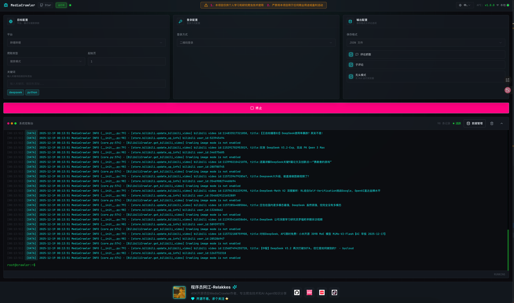
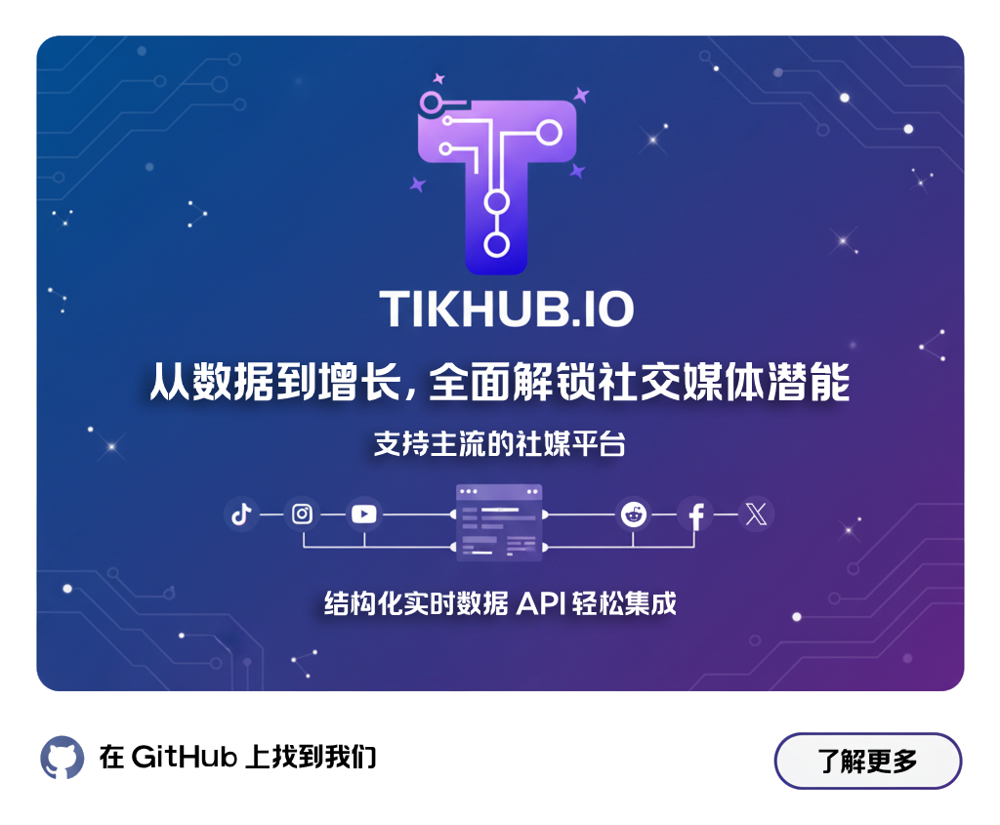
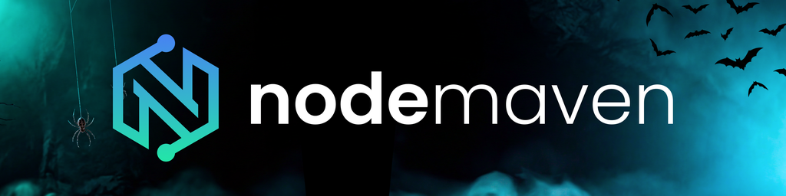
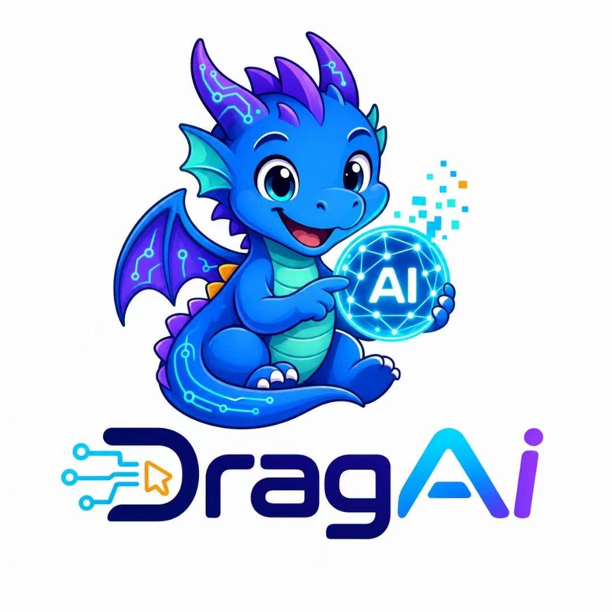
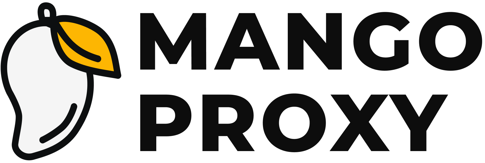
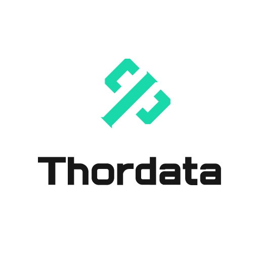

# 🔥 MediaCrawler - 自媒体平台爬虫 🕷️

<div align="center">

<sub>📢 首页赞助位虚位以待 · 合作请联系 <a href="mailto:relakkes@gmail.com">relakkes@gmail.com</a></sub>

</div>

---

<div align="center">

<a href="https://trendshift.io/repositories/8291" target="_blank">
  
</a>

[](https://atomgit.com/NanmiCoder/MediaCrawler)

[](https://github.com/NanmiCoder/MediaCrawler/stargazers)
[](https://github.com/NanmiCoder/MediaCrawler/network/members)
[](https://github.com/NanmiCoder/MediaCrawler/issues)
[](https://github.com/NanmiCoder/MediaCrawler/pulls)
[](https://github.com/NanmiCoder/MediaCrawler/blob/main/LICENSE)
[](README.md)
[](README_en.md)
[](README_es.md)
</div>


> [!CAUTION]
> **免责声明（请务必阅读）**
>
> 大家请以学习为目的使用本仓库 ⚠️⚠️⚠️⚠️，[爬虫违法违规的案件](https://github.com/HiddenStrawberry/Crawler_Illegal_Cases_In_China)
>
> 本仓库的所有内容仅供学习和参考之用，禁止用于商业用途。任何人或组织不得将本仓库的内容用于非法用途或侵犯他人合法权益。本仓库所涉及的爬虫技术仅用于学习和研究，不得用于对其他平台进行大规模爬虫或其他非法行为。对于因使用本仓库内容而引起的任何法律责任，本仓库不承担任何责任。使用本仓库的内容即表示您同意本免责声明的所有条款和条件。
>
> 点击查看更为详细的免责声明：[点击跳转](#disclaimer)


## 📖 项目简介

一个用于学习与研究的**多平台自媒体数据采集工具**，支持小红书、抖音、快手、B站、微博、贴吧、知乎等主流平台的公开信息抓取。

- **技术原理**：基于 [Playwright](https://playwright.dev/) 浏览器自动化框架保留登录态，在浏览器上下文中通过 JS 表达式获取签名参数，**无需 JS 逆向**复杂的加密算法，大幅降低爬虫学习门槛。


## ✨ 功能特性
| 平台   | 关键词搜索 | 指定帖子ID爬取 | 二级评论 | 指定创作者主页 | 登录态缓存 | IP代理池 | 生成评论词云图 |
| ------ | ---------- | -------------- | -------- | -------------- | ---------- | -------- | -------------- |
| 小红书 | ✅          | ✅              | ✅        | ✅              | ✅          | ✅        | ✅              |
| 抖音   | ✅          | ✅              | ✅        | ✅              | ✅          | ✅        | ✅              |
| 快手   | ✅          | ✅              | ✅        | ✅              | ✅          | ✅        | ✅              |
| B 站   | ✅          | ✅              | ✅        | ✅              | ✅          | ✅        | ✅              |
| 微博   | ✅          | ✅              | ✅        | ✅              | ✅          | ✅        | ✅              |
| 贴吧   | ✅          | ✅              | ✅        | ✅              | ✅          | ✅        | ✅              |
| 知乎   | ✅          | ✅              | ✅        | ✅              | ✅          | ✅        | ✅              |


## ⚡ MediaCrawlerPro（个人进阶源码版）

> 专注于学习成熟项目的架构设计，不仅仅是爬虫技术，Pro 版本的代码设计与 AI Agent 工程实践同样值得深入学习！（**仅限个人学习与源码研究，不面向商业用途**）

| 对比维度 | 开源版（当前仓库） | [MediaCrawlerPro](https://github.com/MediaCrawlerPro) |
| :--- | :--- | :--- |
| 运行与依赖 | 依赖 Playwright / 本地 Chrome | **去除 Playwright 依赖**，支持完整 Linux 环境学习与运行 |
| 架构与机制 | 单账号基础学习示例 | **解耦 JS 签名逻辑**，支持**断点续爬**、**多账号 + IP 代理池**机制 |
| 数据结构覆盖 | 搜索 / 帖子详情 / 评论 / 创作者 | 额外支持**首页信息流（HomeFeed）**与**热搜榜单** |
| AI Agent 与扩展项目 | — | 内置 **AI Agent Skill** + **多套 AI Agent / 全栈桌面端项目源码** |

👉 开源不易，欢迎订阅支持：**[查看 MediaCrawlerPro 项目主页](https://github.com/MediaCrawlerPro)** ｜ **[查看订阅方式](https://nanmicoder.github.io/MediaCrawler/mediacrawlerpro%E8%AE%A2%E9%98%85.html)**

<details>
<summary>📦 <b>点击展开：查看 Pro 版详细特性与附赠 AI Agent 项目源码清单</b></summary>

<br>

- **源码架构设计**：彻底重构解耦 JS 签名逻辑，去除重型浏览器依赖，模块划分清晰、扩展性强，适合深入学习爬虫工程架构。
- **AI Agent Skill 一键接入**：支持 Codex / [OpenClaw](https://openclaw.ai/) 🦞 / [Hermes](https://github.com/NousResearch/hermes-agent) / Claude Code / [DeepSeek Harness](https://github.com/deepseek-ai/deepseek-harness) / [cc-haha](https://github.com/NanmiCoder/cc-haha) / WorkBuddy / 豆包 / Trae / Qoder / Cursor 一键安装，体验让 Agent 自动调用采集能力。
- **附赠学习项目源码**：
  - 🆕 **评论分析 Agent**：输入关键词或链接，自动采集评论并生成研究报告
  - **自媒体内容拆解 Agent**：解析内容、视频转文字、拆解爆款元素
  - **AI 图片生成 Agent**：多轮迭代自动优化，内置精选模板库
  - **自媒体视频下载器桌面端**：适合学习全栈桌面端开发

</details>


## 🚀 快速开始

### 1. 环境准备

- **uv（推荐）**：[官方安装指南](https://docs.astral.sh/uv/getting-started/installation)，安装后执行 `uv --version` 验证
- **Node.js**：版本 `>= 16.0.0`，[官网下载](https://nodejs.org/en/download/)

### 2. 安装依赖

```shell
cd MediaCrawler
uv sync
```

> 默认使用 CDP 模式连接本地 Chrome，**无需安装 Playwright 驱动**；若切换为标准 Playwright 模式（在 `config/base_config.py` 中设 `ENABLE_CDP_MODE = False`），需先执行 `uv run playwright install`。

### 3. 开启 Chrome 远程调试（默认 CDP 模式）

连接已有的 Chrome 浏览器可复用登录态、Cookie 与扩展，降低风控风险：

1. 安装最新版 Chrome（版本 `>= 144`），[下载地址](https://www.google.com/chrome/)
2. 地址栏打开 `chrome://inspect/#remote-debugging`，勾选 **Allow remote debugging for this browser instance**
3. 页面出现 `Server running at: 127.0.0.1:9222` 即就绪

> 💡 运行爬虫后 Chrome 会弹出确认框，60 秒内点击「接受」即可。

### 4. 运行爬虫

```shell
# 更多配置项见 config/base_config.py（含中文注释）

# 按关键词搜索帖子及评论（打开对应 APP 扫码登录）
uv run main.py --platform xhs --lt qrcode --type search

# 按指定帖子 ID 爬取详情及评论
uv run main.py --platform xhs --lt qrcode --type detail

# 查看其他平台与参数示例
uv run main.py --help
```

<details>
<summary>📥 <strong>媒体下载（封面 / 视频 / 图文图片）</strong></summary>

默认关闭。开启后会在爬取的同时把媒体文件下载到本地，按帖子聚合存放：

```shell
# 命令行开关
uv run main.py --platform xhs --type detail --specified_id <帖子URL或ID> --get_media true

# 或在 config/base_config.py 中设置 ENABLE_GET_MEDIA = True
```

**落盘结构**（`SAVE_DATA_PATH` 为空时落在 `data/` 下）：

```
data/xhs/media/{帖子ID}/
├── cover.jpg     # 封面
├── video.mp4     # 视频（B站为 DASH 合流产物）
├── 001.jpg       # 图文帖的图片
└── 001_live.mp4  # 对应图片的实况随附视频（有实况时）
```

**支持平台**：小红书、抖音、快手、B站、微博。贴吧与知乎的数据结构中没有媒体字段，暂不支持。

**实况照片（Live Photo）**：
- 抖音和小红书由 `config/base_config.py` 中的 `DOWNLOAD_LIVE_PHOTO` 控制（默认 `True`，仅在 `ENABLE_GET_MEDIA` 开启时生效）；设为 `False` 时只保存静态图，不影响普通视频下载
- 实况视频与静态图共用原始序号（如 `001.jpg` / `001_live.mp4`），缺失时保留序号空位；仅保存独立图片与随附视频，不合成系统 Live Photo 或 GIF
- 小红书 Web 返回的实况视频可能自带水印，下载保留原始文件内容

**关于 B 站**：
- 安装 [ffmpeg](https://ffmpeg.org/) 后可走 DASH 路径获取最高画质（音视频分轨下载后无损合流）；未安装时自动降级为 mp4 直链，产物名为 `video-durl.mp4` 以便区分
- 清晰度由 `config/bilibili_config.py` 的 `BILI_QN` 控制（默认 80 = 1080p）；未登录或权限不足时若高清取流被拒，会自动逐档降级到实际可下载的清晰度

**说明**：
- 媒体下载失败只记录日志，不会中断爬取
- 已存在的文件会被跳过；需要重新下载时删掉对应目录即可
- 下载是串行跟随爬取流程的（未做并发下载），避免给平台 CDN 造成压力

</details>

<details>
<summary>🖥️ <strong>WebUI 可视化操作界面</strong></summary>

MediaCrawler 提供了基于 Web 的可视化操作界面，无需命令行也能轻松使用爬虫功能。

#### 开发调试（推荐）

开发时需要同时启动后端 API 服务和前端 Vite 开发服务器：

```shell
# 终端 1：启动 API 服务器（默认端口 8080）
uv run uvicorn api.main:app --port 8080 --reload

# 终端 2：启动前端开发服务器
cd webui
npm install
npm run dev        # 默认在 5173 端口启动，并代理 /api 到 8080
```

启动成功后，访问 `http://localhost:5173/` 即可打开 WebUI 界面。

> 首次打开会进行环境检测（调用 `/api/env/check`），请确保后端服务已启动。如果检测失败，可点击「跳过检测」临时跳过。

#### 构建生产资源

如果希望通过 API 服务器直接提供 WebUI 静态资源，需要先构建前端：

```shell
cd webui
npm install
npm run build      # 产物输出到 api/webui/
```

构建完成后，只需启动 API 服务器：

```shell
uv run uvicorn api.main:app --port 8080 --reload
```

然后访问 `http://localhost:8080` 即可。

#### WebUI 功能特性

- 可视化配置爬虫参数（平台、登录方式、爬取类型等）
- 实时查看爬虫运行状态和日志
- 数据预览和导出

#### 界面预览



</details>

<details>
<summary>🔗 <strong>使用 Python 原生 venv 管理环境（不推荐）</strong></summary>

> 爬取抖音和知乎需提前安装 Node.js（`>= 16`）；`requirements.txt` 基于 Python 3.11。

```shell
cd MediaCrawler
python -m venv venv

# 激活虚拟环境（macOS/Linux 用第一条，Windows 用第二条）
source venv/bin/activate
# venv\Scripts\activate

pip install -r requirements.txt
playwright install

# 运行示例（把上面快速开始中的 uv run 换成 python 即可）
python main.py --platform xhs --lt qrcode --type search
```

</details>


## 💾 数据保存

MediaCrawler 支持 CSV、JSON、JSONL、Excel、SQLite 和 MySQL 等多种存储方式，详见 [数据存储指南](docs/data_storage_guide.md)；更多配置与常见问题见 [完整文档](https://nanmicoder.github.io/MediaCrawler/)。


## 💰 赞助商展示

<table>
  <thead>
    <tr>
      <th width="220">赞助商</th>
      <th align="left">介绍</th>
    </tr>
  </thead>
  <tbody>
    <tr>
      <td align="center" valign="middle">
        <a href="https://tikhub.io/?utm_source=github.com/NanmiCoder/MediaCrawler&utm_medium=marketing_social&utm_campaign=retargeting&utm_content=carousel_ad"></a>
      </td>
      <td valign="middle">
        <a href="https://tikhub.io/?utm_source=github.com/NanmiCoder/MediaCrawler&utm_medium=marketing_social&utm_campaign=retargeting&utm_content=carousel_ad">TikHub.io</a> 提供 900+ 高稳定性数据接口，覆盖 TK、DY、XHS、Y2B、Ins、X 等 14+ 海内外主流平台，支持用户、内容、商品、评论等多维度公开数据 API，并配套 4000 万+ 已清洗结构化数据集，使用邀请码 <code>cfzyejV9</code> <a href="https://tikhub.io/?utm_source=github.com/NanmiCoder/MediaCrawler&utm_medium=marketing_social&utm_campaign=retargeting&utm_content=carousel_ad">注册并充值</a>，即可额外获得 $2 赠送额度。
      </td>
    </tr>
    <tr>
      <td align="center" valign="middle">
        <a href="https://go.nodemaven.com/MediaCrawleroctober"></a>
      </td>
      <td valign="middle">
        <a href="https://go.nodemaven.com/MediaCrawleroctober">NodeMaven</a> 是面向网页抓取和自动化场景的高效代理服务商，提供市面上最高质量的 IP。主要优势包括 99.9% 可用性、ZIP 邮编定位、IP 过滤（所有代理的欺诈评分均低于 97%）、无需 KYC，以及代理带宽检测器、Meta 标签检测器、IP 查询等独家免费工具。MediaCrawler 用户使用优惠码 <code>CRAWLER35</code> 可享移动和住宅代理 35% 折扣，使用 <code>CRAWLER40</code> 可享 ISP（静态）代理 40% 折扣。黑五期间，使用优惠码 <code>CRAWLER2X</code> 可获得双倍流量。👉 <a href="https://go.nodemaven.com/MediaCrawleroctober">访问 NodeMaven</a>
      </td>
    </tr>
    <tr>
      <td align="center" valign="middle">
        <a href="https://dragtokens.com"></a>
      </td>
      <td valign="middle">
        感谢 <a href="https://dragtokens.com">DragTokens（Drag API）</a> 对本项目的赞助！DragTokens 专注于为开发者提供多模型 API 中转服务，支持 Claude Code、Codex、Gemini CLI 等 AI 编程工具，覆盖 GPT、Claude、Gemini 等主流模型。Claude 官方客户端专用分组倍率低至 1.1×（对比官方 API 约 1.55 折，节省约 84.5%）、Codex 倍率低至 0.3×（约 0.42 折，节省约 96%）、Gemini 倍率低至 0.25×（约 0.35 折，节省约 96.5%），号池峰值 TPM 达 7 亿。<br><br>
        🎁 通过 <a href="https://dragtokens.com">专属链接</a>注册的新用户即送赠金，单次充值满 100 元还可享受 10% 返现！配套新手入门、工具配置及 API 示例文档，接入有教程，使用有指引。不存储您的提示词与模型回复，并为企业及高校团队提供专属账户池、对公转账与开票支持。
      </td>
    </tr>
    <tr>
      <td align="center" valign="middle">
        <a href="https://mangoproxy.com/?utm_medium=partner&amp;utm_campaign=nanmicoder_github"><picture><source media="(prefers-color-scheme: dark)" srcset="docs/static/images/mangoproxy_logo_dark.png"></picture></a>
      </td>
      <td valign="middle">
        <a href="https://mangoproxy.com/?utm_medium=partner&amp;utm_campaign=nanmicoder_github">MangoProxy</a> 为网页抓取、自动化和数据采集提供住宅、ISP、数据中心及移动代理，拥有覆盖 200 多个国家的 9000 万以上 IP，支持 HTTP(S)、SOCKS5、灵活的 IP 轮换和 API 接入。使用优惠码 <code>CODER</code> 购买静态 ISP 代理可享 <strong>7% 优惠</strong>。👉 <a href="https://mangoproxy.com/?utm_medium=partner&amp;utm_campaign=nanmicoder_github">访问 MangoProxy</a>
      </td>
    </tr>
    <tr>
      <td align="center" valign="middle">
        <a href="https://www.thordata.com/?ls=dmr&amp;lk=dmr"></a>
      </td>
      <td valign="middle">
        <a href="https://www.thordata.com/?ls=dmr&amp;lk=dmr">ThorData</a> 提供覆盖 190+ 国家和地区、1 亿+ 住宅 IP 的代理网络，支持国家、城市和 ASN 定位，以及旋转和粘性会话。适合 MediaCrawler 用户进行小红书、抖音、B 站等平台的公开内容、评论和创作者数据采集，支持 HTTP(S)，并提供 API 文档，方便开发者接入现有的 Python、Playwright 和爬虫项目。住宅代理低至 $0.65/GB，MediaCrawler 用户可领取 3 天免绑卡试用；使用优惠码 <code>Crawler10</code> 可享<strong>额外 10% 折扣</strong>。👉 <a href="https://www.thordata.com/?ls=dmr&amp;lk=dmr">立即体验 ThorData</a>
      </td>
    </tr>
  </tbody>
</table>

---

## 🤝 成为赞助者

成为赞助者，可以将您的产品展示在这里，每天获得大量曝光！

**联系方式**：
- 微信：`relakkes`
- 邮箱：`relakkes@gmail.com`

---

## 🧩 我的其他项目
- **正在创业做的项目**：[ModelDial](https://modeldial.com/?utm_source=github&utm_medium=referral&utm_campaign=mediacrawler&utm_content=readme-zh) — 在私有数据集上实测 AI 模型，对比能力、费用和思考档位，帮你找到适合自己任务的模型
- **开源桌面端 Agent**：[cc-haha](https://github.com/NanmiCoder/cc-haha) — 本地优先、跨平台的 Agent 桌面工作台，支持多 Agent 协作、Git Worktree、技能市场、多模型与 Computer Use，并可通过微信 / 飞书 / 钉钉等远程接入
- **DeepSeek Harness 插件**：[dsh-agent-teams](https://github.com/NanmiCoder/dsh-agent-teams) — 给 DeepSeek Harness 装上 Agent Teams，让多个 Agent 组队并行协作完成复杂任务


## 💬 交流群组
- **微信交流群**：[点击加入](https://nanmicoder.github.io/MediaCrawler/%E5%BE%AE%E4%BF%A1%E4%BA%A4%E6%B5%81%E7%BE%A4.html)
- **B站账号**：[关注我](https://space.bilibili.com/434377496)，分享 AI 与爬虫技术知识


## ☕ 请作者喝杯咖啡

如果这个项目对您有帮助，欢迎打赏支持，您的每一份支持都是我持续更新的动力 ❤️

<table>
<tr>
<td align="center" width="33%">
<br>
<b>微信赞赏</b>
</td>
<td align="center" width="33%">
<br>
<b>支付宝</b>
</td>
<td align="center" width="33%">
<a href="https://buymeacoffee.com/relakkes" target="_blank">

</a><br>
<b>Buy Me a Coffee</b>
</td>
</tr>
</table>

---


## ⭐ Star 趋势图

如果这个项目对您有帮助，请给个 ⭐ Star 支持一下，让更多的人看到 MediaCrawler！

[](https://www.repostars.dev/?repos=NanmiCoder%2FMediaCrawler&theme=ocean)


## 📚 参考

- **小红书签名仓库**：[Cloxl 的 xhs 签名仓库](https://github.com/Cloxl/xhshow)
- **小红书客户端**：[ReaJason 的 xhs 仓库](https://github.com/ReaJason/xhs)
- **短信转发**：[SmsForwarder 参考仓库](https://github.com/pppscn/SmsForwarder)
- **内网穿透工具**：[ngrok 官方文档](https://ngrok.com/docs/)


## ⚖️ 免责声明
<div id="disclaimer">

### 1. 项目目的与性质
本项目（以下简称“本项目”）是作为一个技术研究与学习工具而创建的，旨在探索和学习网络数据采集技术。本项目专注于自媒体平台的数据爬取技术研究，旨在提供给学习者和研究者作为技术交流之用。

### 2. 法律合规性声明
本项目开发者（以下简称“开发者”）郑重提醒用户在下载、安装和使用本项目时，严格遵守中华人民共和国相关法律法规，包括但不限于《中华人民共和国网络安全法》、《中华人民共和国反间谍法》等所有适用的国家法律和政策。用户应自行承担一切因使用本项目而可能引起的法律责任。

### 3. 使用目的限制
本项目严禁用于任何非法目的或非学习、非研究的商业行为。本项目不得用于任何形式的非法侵入他人计算机系统，不得用于任何侵犯他人知识产权或其他合法权益的行为。用户应保证其使用本项目的目的纯属个人学习和技术研究，不得用于任何形式的非法活动。

### 4. 免责声明
开发者已尽最大努力确保本项目的正当性及安全性，但不对用户使用本项目可能引起的任何形式的直接或间接损失承担责任。包括但不限于由于使用本项目而导致的任何数据丢失、设备损坏、法律诉讼等。

### 5. 知识产权声明
本项目的知识产权归开发者所有。本项目受到著作权法和国际著作权条约以及其他知识产权法律和条约的保护。用户在遵守本声明及相关法律法规的前提下，可以下载和使用本项目。

### 6. 最终解释权
关于本项目的最终解释权归开发者所有。开发者保留随时更改或更新本免责声明的权利，恕不另行通知。
</div>
