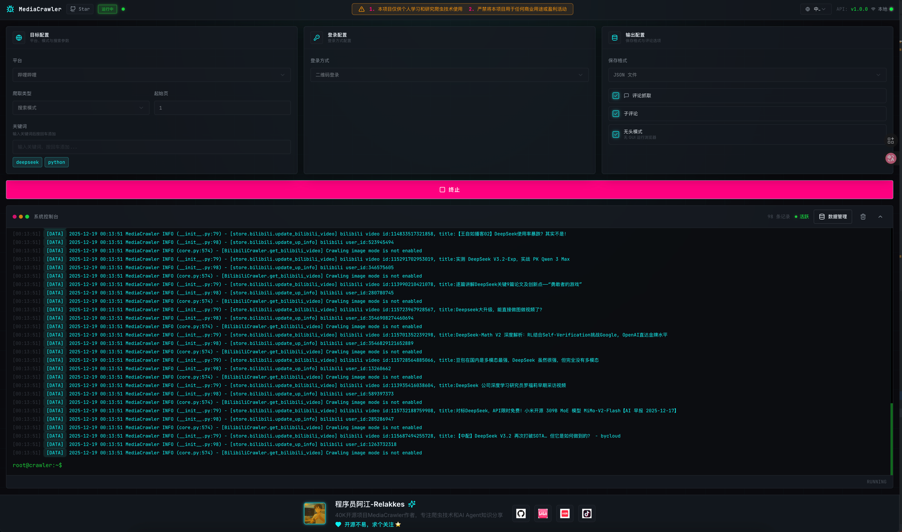
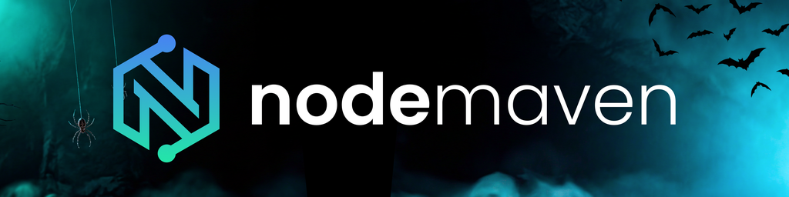
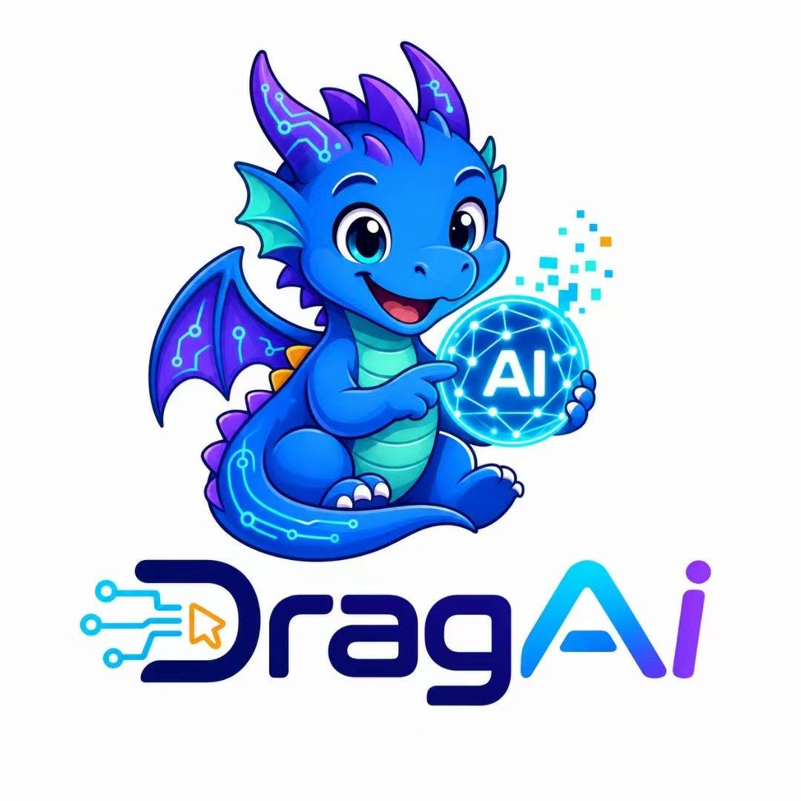
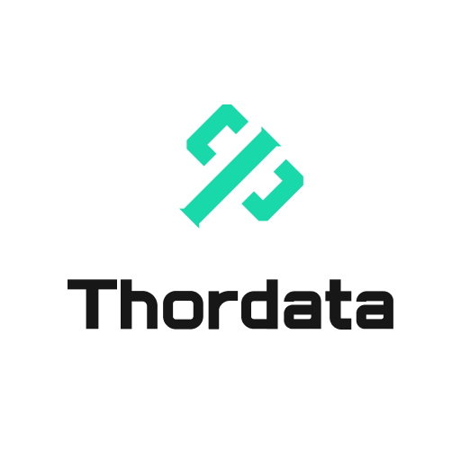

# 🔥 MediaCrawler - Social Media Platform Crawler 🕷️

<div align="center">

<sub>📢 This top sponsor spot is open · Contact <a href="mailto:relakkes@gmail.com">relakkes@gmail.com</a></sub>

</div>

---

<div align="center">

<a href="https://trendshift.io/repositories/8291" target="_blank">
  
</a>

[](https://atomgit.com/NanmiCoder/MediaCrawler)

[](https://github.com/NanmiCoder/MediaCrawler/stargazers)
[](https://github.com/NanmiCoder/MediaCrawler/network/members)
[](https://github.com/NanmiCoder/MediaCrawler/issues)
[](https://github.com/NanmiCoder/MediaCrawler/pulls)
[](https://github.com/NanmiCoder/MediaCrawler/blob/main/LICENSE)
[](README.md)
[](README_en.md)
[](README_es.md)

</div>

> [!CAUTION]
> **Disclaimer (Please Read Carefully)**
>
> Please use this repository for learning purposes only ⚠️⚠️⚠️⚠️, [Web scraping illegal cases](https://github.com/HiddenStrawberry/Crawler_Illegal_Cases_In_China)
>
> All content in this repository is for learning and reference purposes only, and commercial use is prohibited. No person or organization may use the content of this repository for illegal purposes or infringe upon the legitimate rights and interests of others. The web scraping technology involved in this repository is only for learning and research, and may not be used for large-scale crawling of other platforms or other illegal activities. This repository assumes no legal responsibility for any legal liability arising from the use of the content of this repository. By using the content of this repository, you agree to all terms and conditions of this disclaimer.
>
> Click to view a more detailed disclaimer: [Click to jump](#disclaimer)


## 📖 Project Introduction

A **multi-platform social media data collection tool** for learning and research, supporting public information collection from Xiaohongshu, Douyin, Kuaishou, Bilibili, Weibo, Tieba, Zhihu, and more.

- **Technical Principle**: Built on the [Playwright](https://playwright.dev/) browser automation framework to preserve login state and obtain signature parameters via JS expressions inside the browser context — **no JS reverse engineering** of complex encryption algorithms required, significantly lowering the learning barrier.

## ✨ Features
| Platform | Keyword Search | Specific Post ID Crawling | Secondary Comments | Specific Creator Homepage | Login State Cache | IP Proxy Pool | Generate Comment Word Cloud |
| ------ | ---------- | -------------- | -------- | -------------- | ---------- | -------- | -------------- |
| Xiaohongshu | ✅          | ✅              | ✅        | ✅              | ✅          | ✅        | ✅              |
| Douyin   | ✅          | ✅              | ✅        | ✅              | ✅          | ✅        | ✅              |
| Kuaishou   | ✅          | ✅              | ✅        | ✅              | ✅          | ✅        | ✅              |
| Bilibili   | ✅          | ✅              | ✅        | ✅              | ✅          | ✅        | ✅              |
| Weibo   | ✅          | ✅              | ✅        | ✅              | ✅          | ✅        | ✅              |
| Tieba   | ✅          | ✅              | ✅        | ✅              | ✅          | ✅        | ✅              |
| Zhihu   | ✅          | ✅              | ✅        | ✅              | ✅          | ✅        | ✅              |


## ⚡ MediaCrawlerPro (Personal Learning Source Edition)

> Focus on learning mature project architectural design — not just crawling technology, the Pro version's code design and AI Agent engineering practices are equally worth in-depth study! (**For personal learning and source code study only; not for commercial use**)

| Comparison | Open-Source Edition (This Repo) | [MediaCrawlerPro](https://github.com/MediaCrawlerPro) |
| :--- | :--- | :--- |
| Runtime & Dependencies | Requires Playwright / local Chrome | **Removes Playwright dependency**, full Linux environment support for learning and running |
| Architecture & Mechanisms | Single-account learning example | **Decoupled JS signature logic**, **resume crawling**, and **multi-account + IP proxy pool** mechanisms |
| Data Structure Coverage | Search / Post Detail / Comments / Creator | Additional support for **HomeFeed recommendations** and **trending lists** |
| AI Agent & Bonus Projects | — | Built-in **AI Agent Skill** + **multiple AI Agent / full-stack desktop app source repos** |

👉 Open source is not easy, welcome to subscribe and support: **[View MediaCrawlerPro Project Homepage](https://github.com/MediaCrawlerPro)** ｜ **[Subscription Guide](https://nanmicoder.github.io/MediaCrawler/mediacrawlerpro%E8%AE%A2%E9%98%85.html)**

<details>
<summary>📦 <b>Click to expand: Full Pro features & included AI Agent learning projects</b></summary>

<br>

- **Source Architecture Design**: Refactored with decoupled JS signature logic and no heavy browser dependency — clean module boundaries and high extensibility for deeper crawler architecture study.
- **One-Click AI Agent Skill**: Supports Codex / [OpenClaw](https://openclaw.ai/) 🦞 / [Hermes](https://github.com/NousResearch/hermes-agent) / Claude Code / [DeepSeek Harness](https://github.com/deepseek-ai/deepseek-harness) / [cc-haha](https://github.com/NanmiCoder/cc-haha) / WorkBuddy / Doubao / Trae / Qoder / Cursor, allowing agents to invoke collection workflows automatically.
- **Included Learning Project Source Code**:
  - 🆕 **Comment Analysis Agent**: Enter keywords or links to collect comments and generate research reports automatically
  - **Content Deconstruction Agent**: Parse posts, transcribe videos, and break down viral elements
  - **AI Image Generation Agent**: Multi-round iterative refinement with curated prompt templates
  - **Social Media Video Downloader Desktop App**: Ideal for studying full-stack desktop development

</details>


## 🚀 Quick Start

### 1. Prerequisites

- **uv (Recommended)**: [Official Installation Guide](https://docs.astral.sh/uv/getting-started/installation); verify with `uv --version`
- **Node.js**: Version `>= 16.0.0`, [Download](https://nodejs.org/en/download/)

### 2. Install Dependencies

```shell
cd MediaCrawler
uv sync
```

> By default, CDP mode connects to your local Chrome browser, so **no Playwright browser driver is needed**. If you switch to standard Playwright mode (set `ENABLE_CDP_MODE = False` in `config/base_config.py`), run `uv run playwright install` first.

### 3. Enable Chrome Remote Debugging (Default CDP Mode)

Connecting to your existing Chrome browser reuses existing login sessions, cookies, and extensions to reduce anti-bot risk:

1. Install the latest Chrome (`>= 144`): [Download](https://www.google.com/chrome/)
2. Open `chrome://inspect/#remote-debugging` in Chrome and check **Allow remote debugging for this browser instance**
3. Confirm the page displays `Server running at: 127.0.0.1:9222`

> 💡 When the crawler starts, Chrome will show a confirmation dialog — click **Allow / Accept** within 60 seconds.

### 4. Run the Crawler

```shell
# See config/base_config.py for all configuration options (with inline comments)

# Search posts & comments by keywords (scan QR code in the platform app to log in)
uv run main.py --platform xhs --lt qrcode --type search

# Fetch details & comments for specified post IDs
uv run main.py --platform xhs --lt qrcode --type detail

# View usage examples for other platforms
uv run main.py --help
```

<details>
<summary>📥 <strong>Media Download (Cover / Video / Image Posts)</strong></summary>

Disabled by default. When enabled, media files are downloaded locally alongside crawling and grouped by post:

```shell
# CLI flag
uv run main.py --platform xhs --type detail --specified_id <Post URL or ID> --get_media true

# Or set ENABLE_GET_MEDIA = True in config/base_config.py
```

**Output structure** (under `data/` when `SAVE_DATA_PATH` is empty):

```
data/xhs/media/{post_id}/
├── cover.jpg     # Cover image
├── video.mp4     # Video (merged DASH stream on Bilibili)
├── 001.jpg       # Image from image posts
└── 001_live.mp4  # Accompanying Live Photo video (when present)
```

**Supported platforms**: Xiaohongshu, Douyin, Kuaishou, Bilibili, Weibo. Tieba and Zhihu do not expose media fields in their data structures and are not supported yet.

**Live Photo**:
- Controlled by `DOWNLOAD_LIVE_PHOTO` in `config/base_config.py` for Douyin and Xiaohongshu (default `True`, effective only when `ENABLE_GET_MEDIA` is enabled); setting it to `False` saves static images only without affecting regular video downloads
- Live Photo videos share the original image index (e.g., `001.jpg` / `001_live.mp4`), keeping index gaps when items are missing; saved as standalone images and companion videos (not merged into OS Live Photos or converted to GIF)
- Xiaohongshu web Live Photo videos may include watermarks; downloads keep the original stream as returned

**Bilibili notes**:
- With [ffmpeg](https://ffmpeg.org/) installed, Bilibili uses DASH to fetch highest quality and losslessly mux audio/video; without it, it falls back to a direct mp4 link saved as `video-durl.mp4`
- Quality is controlled by `BILI_QN` in `config/bilibili_config.py` (default `80` = 1080p), with automatic fallback to lower resolutions if unauthenticated or restricted

**Notes**:
- Media download failures are logged and do not interrupt crawling
- Existing files are skipped; delete the corresponding folder to re-download
- Downloads run sequentially alongside crawling (no concurrent download bursts) to avoid putting load on platform CDNs

</details>

<details>
<summary>🖥️ <strong>WebUI Visual Operation Interface</strong></summary>

MediaCrawler provides a web-based visual operation interface, allowing you to easily use crawler features without command line.

#### Development (recommended)

For development, you need to start both the backend API service and the frontend Vite dev server:

```shell
# Terminal 1: start API server (default port 8080)
uv run uvicorn api.main:app --port 8080 --reload

# Terminal 2: start frontend dev server
cd webui
npm install
npm run dev        # starts on port 5173 by default and proxies /api to 8080
```

After successful startup, visit `http://localhost:5173/` to open the WebUI interface.

> On first launch, an environment check is performed (calls `/api/env/check`), so make sure the backend service is running. If the check fails, you can click "Skip Check" to bypass it temporarily.

#### Build for Production

If you want the API server to serve the WebUI static assets directly, build the frontend first:

```shell
cd webui
npm install
npm run build      # outputs to api/webui/
```

Then start only the API server:

```shell
uv run uvicorn api.main:app --port 8080 --reload
```

After successful startup, visit `http://localhost:8080` to open the WebUI interface.

#### WebUI Features

- Visualize crawler parameter configuration (platform, login method, crawling type, etc.)
- Real-time view of crawler running status and logs
- Data preview and export

#### Interface Preview



</details>

<details>
<summary>🔗 <strong>Using Python native venv environment management (Not recommended)</strong></summary>

> Node.js (`>= 16`) is required when crawling Douyin or Zhihu; `requirements.txt` is based on Python 3.11.

```shell
cd MediaCrawler
python -m venv venv

# Activate virtual environment (first line for macOS/Linux, second for Windows)
source venv/bin/activate
# venv\Scripts\activate

pip install -r requirements.txt
playwright install

# Run example (replace `uv run` in Quick Start with `python`)
python main.py --platform xhs --lt qrcode --type search
```

</details>


## 💾 Data Storage

MediaCrawler supports CSV, JSON, JSONL, Excel, SQLite, and MySQL. See the [Data Storage Guide](docs/data_storage_guide.md); for more configuration and FAQs, visit the [Complete Documentation](https://nanmicoder.github.io/MediaCrawler/).


## 💰 Sponsor Display

<table>
  <thead>
    <tr>
      <th width="220">Sponsor</th>
      <th align="left">Introduction</th>
    </tr>
  </thead>
  <tbody>
    <tr>
      <td align="center" valign="middle">
        <a href="https://tikhub.io/?utm_source=github.com/NanmiCoder/MediaCrawler&utm_medium=marketing_social&utm_campaign=retargeting&utm_content=carousel_ad"></a>
      </td>
      <td valign="middle">
        <a href="https://tikhub.io/?utm_source=github.com/NanmiCoder/MediaCrawler&utm_medium=marketing_social&utm_campaign=retargeting&utm_content=carousel_ad">TikHub.io</a> provides 900+ highly stable data interfaces, covering 14+ mainstream domestic and international platforms including TK, DY, XHS, Y2B, Ins, X, etc. Supports multi-dimensional public data APIs for users, content, products, comments, etc., with 40M+ cleaned structured datasets. Use invitation code <code>cfzyejV9</code> to <a href="https://tikhub.io/?utm_source=github.com/NanmiCoder/MediaCrawler&utm_medium=marketing_social&utm_campaign=retargeting&utm_content=carousel_ad">register and recharge</a>, and get an additional $2 bonus.
      </td>
    </tr>
    <tr>
      <td align="center" valign="middle">
        <a href="https://go.nodemaven.com/MediaCrawleroctober"></a>
      </td>
      <td valign="middle">
        <a href="https://go.nodemaven.com/MediaCrawleroctober">NodeMaven</a> is an efficient proxy provider for web scraping and automation, offering the highest-quality IPs on the market. Key benefits include 99.9% uptime, ZIP targeting, IP filtering across all proxies (fraud score below 97%), no KYC, and unique free tools such as Proxy Bandwidth Checker, Meta Tag Checker, IP Lookup, and more. MediaCrawler users get 35% off mobile and residential proxies with code <code>CRAWLER35</code>, and 40% off ISP (static) proxies with code <code>CRAWLER40</code>. For Black Friday, use code <code>CRAWLER2X</code> to get double the traffic. 👉 <a href="https://go.nodemaven.com/MediaCrawleroctober">Visit NodeMaven</a>
      </td>
    </tr>
    <tr>
      <td align="center" valign="middle">
        <a href="https://dragtokens.com"></a>
      </td>
      <td valign="middle">
        Thanks to <a href="https://dragtokens.com">DragTokens (Drag API)</a> for sponsoring this project! DragTokens focuses on providing developers with a multi-model API relay service, supporting AI coding tools such as Claude Code, Codex, and Gemini CLI, and covering leading models including GPT, Claude, and Gemini. Rates are as low as 1.1x for the Claude official-client-dedicated group (about 1.55 discount vs. the official API, saving ~84.5%), 0.3x for Codex (about 0.42 discount, saving ~96%), and 0.25x for Gemini (about 0.35 discount, saving ~96.5%), with peak pool throughput reaching 700 million TPM.<br><br>
        🎁 New users who <a href="https://dragtokens.com">register through this exclusive link</a> receive a sign-up credit, and a single top-up of CNY 100 also earns 10% cash back! Documentation covers getting started, tool configuration, and API examples, so setup and usage both come with guidance. Prompts and model responses are never stored, and dedicated account pools, corporate transfer, and invoicing are available for enterprise and university teams.
      </td>
    </tr>
    <tr>
      <td align="center" valign="middle">
        <a href="https://mangoproxy.com/?utm_medium=partner&amp;utm_campaign=nanmicoder_github"><picture><source media="(prefers-color-scheme: dark)" srcset="docs/static/images/mangoproxy_logo_dark.png"></picture></a>
      </td>
      <td valign="middle">
        <a href="https://mangoproxy.com/?utm_medium=partner&amp;utm_campaign=nanmicoder_github">MangoProxy</a> provides residential, ISP, datacenter, and mobile proxies for web scraping, automation, and data collection. With 90M+ IPs across 200+ countries, it supports HTTP(S), SOCKS5, flexible IP rotation, and API access. Use promo code <code>CODER</code> for <strong>7% off static ISP proxies</strong>. 👉 <a href="https://mangoproxy.com/?utm_medium=partner&amp;utm_campaign=nanmicoder_github">Visit MangoProxy</a>
      </td>
    </tr>
    <tr>
      <td align="center" valign="middle">
        <a href="https://www.thordata.com/?ls=dmr&amp;lk=dmr"></a>
      </td>
      <td valign="middle">
        <a href="https://www.thordata.com/?ls=dmr&amp;lk=dmr">ThorData</a> provides a proxy network with 100M+ residential IPs across 190+ countries and regions, supporting country, city, and ASN targeting, as well as rotating and sticky sessions. It helps MediaCrawler users collect public content, comments, and creator data from platforms such as Xiaohongshu, Douyin, and Bilibili. HTTP(S) support and API documentation make it easy to integrate with existing Python, Playwright, and web scraping projects. Residential proxies start at $0.65/GB, and MediaCrawler users can get a 3-day trial with no credit card required. Use promo code <code>Crawler10</code> for an <strong>extra 10% off</strong>. 👉 <a href="https://www.thordata.com/?ls=dmr&amp;lk=dmr">Try ThorData</a>
      </td>
    </tr>
  </tbody>
</table>

---

## 🤝 Become a Sponsor

Become a sponsor and showcase your product here, getting massive exposure daily!

**Contact Information**:
- WeChat: `relakkes`
- Email: `relakkes@gmail.com`

---

## 🧩 My Other Projects
- **The Startup I'm Building**: [ModelDial](https://modeldial.com/?utm_source=github&utm_medium=referral&utm_campaign=mediacrawler&utm_content=readme-en) — benchmarks AI models on private datasets, comparing capabilities, costs and reasoning effort levels to help you find the right model for your tasks
- **Open Source Desktop Agent**: [cc-haha](https://github.com/NanmiCoder/cc-haha) — a local-first, cross-platform desktop workspace for agents, with multi-agent collaboration, Git worktrees, a skill marketplace, multi-model support and Computer Use, plus remote access via WeChat / Feishu / DingTalk and more
- **DeepSeek Harness Plugin**: [dsh-agent-teams](https://github.com/NanmiCoder/dsh-agent-teams) — brings Agent Teams to DeepSeek Harness, so multiple agents can work in parallel on complex tasks


## 💬 Discussion Groups
- **WeChat Discussion Group**: [Click to join](https://nanmicoder.github.io/MediaCrawler/%E5%BE%AE%E4%BF%A1%E4%BA%A4%E6%B5%81%E7%BE%A4.html)
- **Bilibili Account**: [Follow me](https://space.bilibili.com/434377496), sharing AI and crawler technology knowledge


## ☕ Buy Me a Coffee

If this project helps you, feel free to support my work — every bit of support keeps me motivated to maintain and improve it ❤️

<table>
<tr>
<td align="center" width="33%">
<br>
<b>WeChat Pay</b>
</td>
<td align="center" width="33%">
<br>
<b>Alipay</b>
</td>
<td align="center" width="33%">
<a href="https://buymeacoffee.com/relakkes" target="_blank">

</a><br>
<b>Buy Me a Coffee</b>
</td>
</tr>
</table>

---


## ⭐ Star Trend Chart

If this project helps you, please give a ⭐ Star to support and let more people see MediaCrawler!

[](https://www.repostars.dev/?repos=NanmiCoder%2FMediaCrawler&theme=ocean)


## 📚 References

- **Xiaohongshu Signature Repository**: [Cloxl's xhs signature repository](https://github.com/Cloxl/xhshow)
- **Xiaohongshu Client**: [ReaJason's xhs repository](https://github.com/ReaJason/xhs)
- **SMS Forwarding**: [SmsForwarder reference repository](https://github.com/pppscn/SmsForwarder)
- **Intranet Penetration Tool**: [ngrok official documentation](https://ngrok.com/docs/)


## ⚖️ Disclaimer
<div id="disclaimer">

### 1. Project Purpose and Nature
This project (hereinafter referred to as "this project") was created as a technical research and learning tool, aimed at exploring and learning network data collection technologies. This project focuses on research of data crawling technologies for social media platforms, intended to provide learners and researchers with technical exchange purposes.

### 2. Legal Compliance Statement
The project developer (hereinafter referred to as "developer") solemnly reminds users to strictly comply with relevant laws and regulations of the People's Republic of China when downloading, installing and using this project, including but not limited to the "Cybersecurity Law of the People's Republic of China", "Counter-Espionage Law of the People's Republic of China" and all applicable national laws and policies. Users shall bear all legal responsibilities that may arise from using this project.

### 3. Usage Purpose Restrictions
This project is strictly prohibited from being used for any illegal purposes or non-learning, non-research commercial activities. This project may not be used for any form of illegal intrusion into other people's computer systems, nor may it be used for any activities that infringe upon others' intellectual property rights or other legitimate rights and interests. Users should ensure that their use of this project is purely for personal learning and technical research, and may not be used for any form of illegal activities.

### 4. Disclaimer
The developer has made every effort to ensure the legitimacy and security of this project, but assumes no responsibility for any form of direct or indirect losses that may arise from users' use of this project. Including but not limited to any data loss, equipment damage, legal litigation, etc. caused by using this project.

### 5. Intellectual Property Statement
The intellectual property rights of this project belong to the developer. This project is protected by copyright law and international copyright treaties as well as other intellectual property laws and treaties. Users may download and use this project under the premise of complying with this statement and relevant laws and regulations.

### 6. Final Interpretation Rights
The developer has the final interpretation rights regarding this project. The developer reserves the right to change or update this disclaimer at any time without further notice.
</div>


## 🙏 Acknowledgments

### JetBrains Open Source License Support

Thanks to JetBrains for providing free open source license support for this project!

<a href="https://www.jetbrains.com/?from=MediaCrawler">
    
</a>
