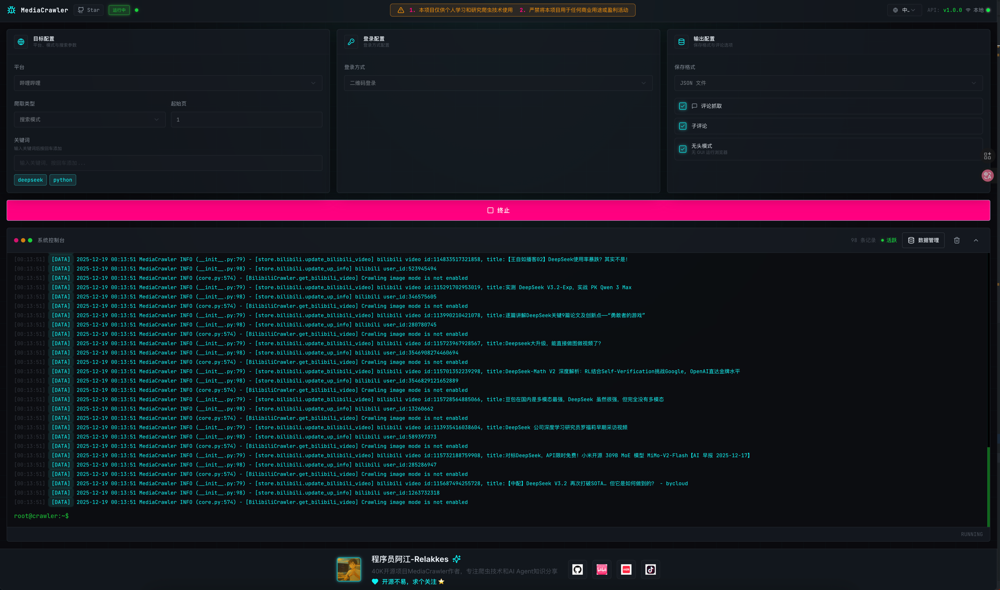
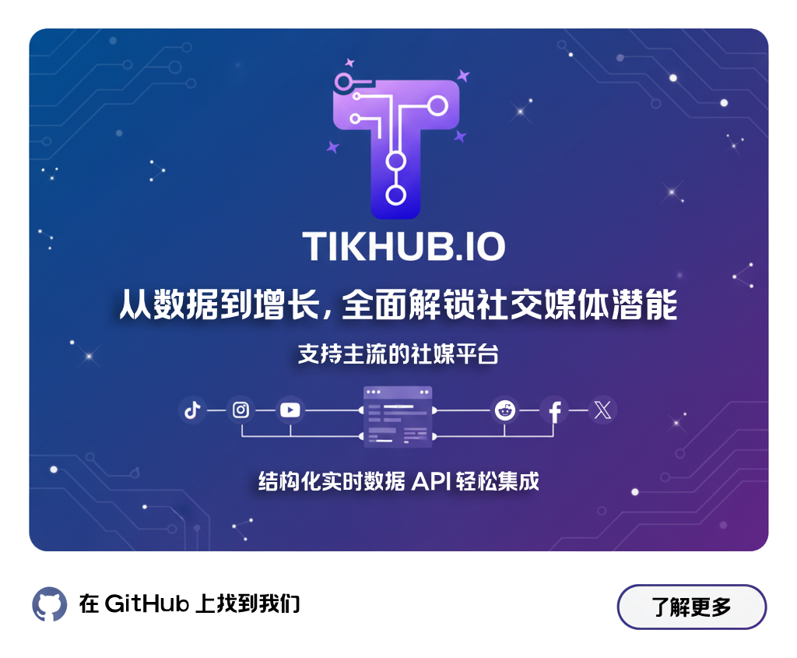
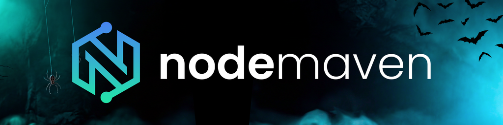
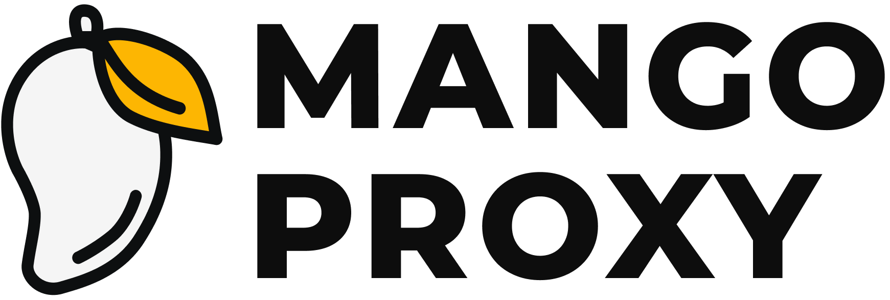
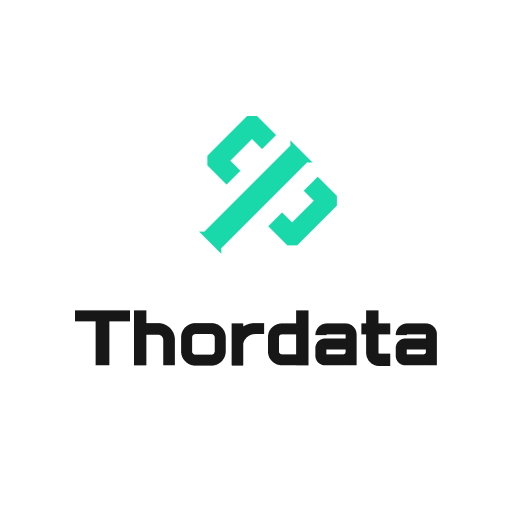

# 🔥 MediaCrawler - Rastreador de Plataformas de Redes Sociales 🕷️

<div align="center">

<sub>📢 Este espacio de patrocinio está disponible · Contacto: <a href="mailto:relakkes@gmail.com">relakkes@gmail.com</a></sub>

</div>

---

<div align="center">

<a href="https://trendshift.io/repositories/8291" target="_blank">
  
</a>

[](https://atomgit.com/NanmiCoder/MediaCrawler)

[](https://github.com/NanmiCoder/MediaCrawler/stargazers)
[](https://github.com/NanmiCoder/MediaCrawler/network/members)
[](https://github.com/NanmiCoder/MediaCrawler/issues)
[](https://github.com/NanmiCoder/MediaCrawler/pulls)
[](https://github.com/NanmiCoder/MediaCrawler/blob/main/LICENSE)
[](README.md)
[](README_en.md)
[](README_es.md)

</div>

> [!CAUTION]
> **Descargo de responsabilidad (Por favor, lea atentamente)**
>
> Por favor, utilice este repositorio únicamente con fines de aprendizaje ⚠️⚠️⚠️⚠️, [Casos ilegales de web scraping](https://github.com/HiddenStrawberry/Crawler_Illegal_Cases_In_China)
>
> Todo el contenido de este repositorio es únicamente para fines de aprendizaje y referencia, y está prohibido el uso comercial. Ninguna persona u organización puede usar el contenido de este repositorio para propósitos ilegales o infringir los derechos e intereses legítimos de otros. La tecnología de web scraping involucrada en este repositorio es solo para aprendizaje e investigación, y no puede ser utilizada para rastreo a gran escala de otras plataformas u otras actividades ilegales. Este repositorio no asume ninguna responsabilidad legal por cualquier responsabilidad legal que surja del uso del contenido de este repositorio. Al usar el contenido de este repositorio, usted acepta todos los términos y condiciones de este descargo de responsabilidad.
>
> Haga clic para ver un descargo de responsabilidad más detallado: [Haga clic para saltar](#disclaimer)


## 📖 Introducción del Proyecto

Una **herramienta de recolección de datos de redes sociales multiplataforma** para aprendizaje e investigación, que soporta la recolección de información pública de Xiaohongshu, Douyin, Kuaishou, Bilibili, Weibo, Tieba, Zhihu y más.

- **Principio Técnico**: Basado en el framework de automatización de navegador [Playwright](https://playwright.dev/) para mantener el estado de sesión y obtener parámetros de firma mediante expresiones JS en el contexto del navegador, **sin necesidad de ingeniería inversa de JS** de algoritmos de cifrado complejos, reduciendo drásticamente la barrera de aprendizaje.

## ✨ Características
| Plataforma | Búsqueda por Palabras Clave | Rastreo de ID de Publicación Específica | Comentarios Secundarios | Página de Inicio de Creador Específico | Caché de Estado de Login | Pool de Proxy IP | Generar Nube de Palabras de Comentarios |
| ------ | ---------- | -------------- | -------- | -------------- | ---------- | -------- | -------------- |
| Xiaohongshu | ✅          | ✅              | ✅        | ✅              | ✅          | ✅        | ✅              |
| Douyin   | ✅          | ✅              | ✅        | ✅              | ✅          | ✅        | ✅              |
| Kuaishou   | ✅          | ✅              | ✅        | ✅              | ✅          | ✅        | ✅              |
| Bilibili   | ✅          | ✅              | ✅        | ✅              | ✅          | ✅        | ✅              |
| Weibo   | ✅          | ✅              | ✅        | ✅              | ✅          | ✅        | ✅              |
| Tieba   | ✅          | ✅              | ✅        | ✅              | ✅          | ✅        | ✅              |
| Zhihu   | ✅          | ✅              | ✅        | ✅              | ✅          | ✅        | ✅              |


## ⚡ MediaCrawlerPro (Edición de Código Fuente para Aprendizaje Personal)

> Enfócate en aprender el diseño arquitectónico de proyectos maduros — no solo tecnología de rastreo, el diseño de código de la versión Pro y sus prácticas de ingeniería con AI Agents también merecen un estudio profundo. (**Solo para aprendizaje personal e investigación de código fuente; no destinado a uso comercial**)

| Comparación | Versión Open Source (Este Repo) | [MediaCrawlerPro](https://github.com/MediaCrawlerPro) |
| :--- | :--- | :--- |
| Ejecución y Dependencias | Requiere Playwright / Chrome local | **Sin dependencia de Playwright**, soporte completo en Linux para aprender y ejecutar |
| Arquitectura y Mecanismos | Ejemplo básico de aprendizaje con una cuenta | **Lógica de firma JS desacoplada**, **reanudación de rastreo** y **multicuenta + pool de proxies IP** |
| Cobertura de Datos | Búsqueda / Detalle / Comentarios / Creador | Soporte adicional de **HomeFeed** y **listas de tendencias** |
| AI Agent y Proyectos Extra | — | Incluye **AI Agent Skill** + **múltiples códigos fuente de AI Agents y app de escritorio full-stack** |

👉 El código abierto no es fácil, bienvenido a suscribirte y apoyar: **[Ver Página del Proyecto MediaCrawlerPro y Guía de Suscripción](https://github.com/MediaCrawlerPro)**

<details>
<summary>📦 <b>Haz clic para expandir: Características completas de Pro y lista de proyectos AI Agent incluidos</b></summary>

<br>

- **Diseño de Arquitectura de Código**: Refactorización completa desacoplando la lógica de firma JS y eliminando la dependencia pesada del navegador; módulos claros y alta extensibilidad para estudiar arquitectura de crawlers.
- **AI Agent Skill en un Clic**: Compatible con Codex / [OpenClaw](https://openclaw.ai/) 🦞 / [Hermes](https://github.com/NousResearch/hermes-agent) / Claude Code / [DeepSeek Harness](https://github.com/deepseek-ai/deepseek-harness) / [cc-haha](https://github.com/NanmiCoder/cc-haha) / WorkBuddy / Doubao / Trae / Qoder / Cursor, permitiendo que los agentes ejecuten flujos de recolección automáticamente.
- **Código Fuente de Proyectos de Aprendizaje Incluidos**:
  - 🆕 **Agente de Análisis de Comentarios**: Introduce palabras clave o enlaces para recopilar comentarios y generar informes de investigación automáticamente
  - **Agente de Deconstrucción de Contenido**: Analiza publicaciones, transcribe videos y desglosa elementos virales
  - **Agente de Generación de Imágenes IA**: Optimización iterativa en múltiples rondas con plantillas seleccionadas
  - **Aplicación de Escritorio Descargadora de Videos**: Ideal para aprender desarrollo full-stack de escritorio

</details>


## 🚀 Inicio Rápido

### 1. Prerrequisitos

- **uv (Recomendado)**: [Guía Oficial de Instalación](https://docs.astral.sh/uv/getting-started/installation); verifica con `uv --version`
- **Node.js**: Versión `>= 16.0.0`, [Descargar](https://nodejs.org/en/download/)

### 2. Instalar Dependencias

```shell
cd MediaCrawler
uv sync
```

> Por defecto, el modo CDP se conecta a tu Chrome local, por lo que **no hace falta instalar el controlador de Playwright**. Si cambias al modo Playwright estándar (`ENABLE_CDP_MODE = False` en `config/base_config.py`), ejecuta primero `uv run playwright install`.

### 3. Activar Depuración Remota en Chrome (Modo CDP Predeterminado)

Conectarse a tu navegador Chrome existente reutiliza sesiones, cookies y extensiones para reducir el riesgo de detección:

1. Instala la última versión de Chrome (`>= 144`): [Descargar](https://www.google.com/chrome/)
2. Abre `chrome://inspect/#remote-debugging` en Chrome y marca **Allow remote debugging for this browser instance**
3. Confirma que la página muestre `Server running at: 127.0.0.1:9222`

> 💡 Al iniciar el rastreador, Chrome mostrará un cuadro de confirmación; haz clic en **Aceptar** en menos de 60 segundos.

### 4. Ejecutar el Rastreador

```shell
# Consulta config/base_config.py para ver todas las opciones (con comentarios)

# Buscar publicaciones y comentarios por palabras clave (escanea el código QR en la app para iniciar sesión)
uv run main.py --platform xhs --lt qrcode --type search

# Obtener detalles y comentarios de IDs de publicaciones específicos
uv run main.py --platform xhs --lt qrcode --type detail

# Ver ejemplos de uso para otras plataformas
uv run main.py --help
```

<details>
<summary>📥 <strong>Descarga de Medios (Portada / Video / Publicaciones con Imágenes)</strong></summary>

Desactivada por defecto. Al activarla, descarga los archivos multimedia localmente junto con el rastreo, agrupados por publicación:

```shell
# Parámetro CLI
uv run main.py --platform xhs --type detail --specified_id <URL o ID de publicación> --get_media true

# O establece ENABLE_GET_MEDIA = True en config/base_config.py
```

**Estructura de salida** (bajo `data/` cuando `SAVE_DATA_PATH` está vacío):

```
data/xhs/media/{post_id}/
├── cover.jpg     # Imagen de portada
├── video.mp4     # Video (flujo DASH combinado en Bilibili)
├── 001.jpg       # Imagen de publicaciones gráficas
└── 001_live.mp4  # Video adjunto de Live Photo (cuando existe)
```

**Plataformas soportadas**: Xiaohongshu, Douyin, Kuaishou, Bilibili, Weibo. Tieba y Zhihu no incluyen campos multimedia en sus estructuras de datos y no están soportadas por ahora.

**Live Photo**:
- Controlado por `DOWNLOAD_LIVE_PHOTO` en `config/base_config.py` para Douyin y Xiaohongshu (`True` por defecto, activo solo cuando `ENABLE_GET_MEDIA` está activado); si es `False`, solo guarda imágenes estáticas sin afectar la descarga de videos normales
- Los videos de Live Photo comparten el índice original de la imagen (p. ej., `001.jpg` / `001_live.mp4`), conservando huecos cuando falte algún archivo; se guardan como imágenes y videos independientes (no se combinan en Live Photo del sistema ni se convierten a GIF)
- Los videos de Live Photo de la web de Xiaohongshu pueden incluir marca de agua; la descarga conserva el contenido original

**Sobre Bilibili**:
- Con [ffmpeg](https://ffmpeg.org/) instalado, utiliza DASH para obtener la máxima calidad y combinar audio/video sin pérdida; sin él, usa un enlace mp4 directo guardado como `video-durl.mp4`
- La calidad se controla con `BILI_QN` en `config/bilibili_config.py` (por defecto `80` = 1080p), descendiendo automáticamente a resoluciones inferiores si no hay sesión o permisos suficientes

**Notas**:
- Los fallos al descargar medios solo se registran en logs y no detienen el rastreo
- Los archivos ya existentes se omiten; borra la carpeta correspondiente para volver a descargar
- Las descargas son secuenciales junto al rastreo (sin ráfagas concurrentes) para no sobrecargar los CDN de las plataformas

</details>

<details>
<summary>🖥️ <strong>Interfaz de Operación Visual WebUI</strong></summary>

MediaCrawler proporciona una interfaz de operación visual basada en web, permitiéndole usar fácilmente las funciones del rastreador sin línea de comandos.

#### Desarrollo (recomendado)

Para el desarrollo, debe iniciar tanto el servicio API backend como el servidor de desarrollo Vite frontend:

```shell
# Terminal 1: iniciar servidor API (puerto predeterminado 8080)
uv run uvicorn api.main:app --port 8080 --reload

# Terminal 2: iniciar servidor de desarrollo frontend
cd webui
npm install
npm run dev        # se inicia en el puerto 5173 por defecto y redirige /api a 8080
```

Después de iniciar exitosamente, visite `http://localhost:5173/` para abrir la interfaz WebUI.

> En el primer inicio, se realiza una verificación de entorno (llama a `/api/env/check`), así que asegúrese de que el servicio backend esté en ejecución. Si la verificación falla, puede hacer clic en "Omitir verificación" para omitirla temporalmente.

#### Construir para Producción

Si desea que el servidor API sirva directamente los recursos estáticos de WebUI, construya el frontend primero:

```shell
cd webui
npm install
npm run build      # salida en api/webui/
```

Luego inicie solo el servidor API:

```shell
uv run uvicorn api.main:app --port 8080 --reload
```

Después de iniciar exitosamente, visite `http://localhost:8080` para abrir la interfaz WebUI.

#### Características de WebUI

- Configuración visual de parámetros del rastreador (plataforma, método de login, tipo de rastreo, etc.)
- Vista en tiempo real del estado de ejecución del rastreador y logs
- Vista previa y exportación de datos

#### Vista Previa de la Interfaz



</details>

<details>
<summary>🔗 <strong>Usando gestión de entorno venv nativo de Python (No recomendado)</strong></summary>

> Se requiere Node.js (`>= 16`) para rastrear Douyin o Zhihu; `requirements.txt` está basado en Python 3.11.

```shell
cd MediaCrawler
python -m venv venv

# Activar entorno virtual (primera línea para macOS/Linux, segunda para Windows)
source venv/bin/activate
# venv\Scripts\activate

pip install -r requirements.txt
playwright install

# Ejemplo de ejecución (sustituye `uv run` del Inicio Rápido por `python`)
python main.py --platform xhs --lt qrcode --type search
```

</details>


## 💾 Almacenamiento de Datos

MediaCrawler soporta CSV, JSON, JSONL, Excel, SQLite y MySQL. Consulta la [Guía de Almacenamiento de Datos](docs/data_storage_guide.md); para más configuraciones y preguntas frecuentes, visita la [Documentación Completa](https://nanmicoder.github.io/MediaCrawler/).


## 💰 Exhibición de Patrocinadores

<table>
  <thead>
    <tr>
      <th width="220">Patrocinador</th>
      <th align="left">Introducción</th>
    </tr>
  </thead>
  <tbody>
    <tr>
      <td align="center" valign="middle">
        <a href="https://tikhub.io/?utm_source=github.com/NanmiCoder/MediaCrawler&utm_medium=marketing_social&utm_campaign=retargeting&utm_content=carousel_ad"></a>
      </td>
      <td valign="middle">
        <a href="https://tikhub.io/?utm_source=github.com/NanmiCoder/MediaCrawler&utm_medium=marketing_social&utm_campaign=retargeting&utm_content=carousel_ad">TikHub.io</a> proporciona 900+ interfaces de datos altamente estables, cubriendo 14+ plataformas principales nacionales e internacionales incluyendo TK, DY, XHS, Y2B, Ins, X, etc. Soporta APIs de datos públicos multidimensionales para usuarios, contenido, productos, comentarios, etc., con 40M+ conjuntos de datos estructurados limpios. Use el código de invitación <code>cfzyejV9</code> para <a href="https://tikhub.io/?utm_source=github.com/NanmiCoder/MediaCrawler&utm_medium=marketing_social&utm_campaign=retargeting&utm_content=carousel_ad">registrarse y recargar</a>, y obtenga $2 adicionales de bonificación.
      </td>
    </tr>
    <tr>
      <td align="center" valign="middle">
        <a href="https://go.nodemaven.com/MediaCrawleroctober"></a>
      </td>
      <td valign="middle">
        <a href="https://go.nodemaven.com/MediaCrawleroctober">NodeMaven</a> es un proveedor eficiente de proxies para web scraping y automatización, con las IP de mayor calidad del mercado. Sus principales ventajas incluyen una disponibilidad del 99,9%, segmentación por código postal, filtrado de IP en todos los proxies (puntuación de fraude inferior al 97%), sin KYC y herramientas gratuitas exclusivas como Proxy Bandwidth Checker, Meta Tag Checker, IP Lookup y más. Los usuarios de MediaCrawler obtienen un 35% de descuento en proxies móviles y residenciales con el código <code>CRAWLER35</code>, y un 40% de descuento en proxies ISP (estáticos) con el código <code>CRAWLER40</code>. Durante el Black Friday, usa el código <code>CRAWLER2X</code> para obtener el doble de tráfico. 👉 <a href="https://go.nodemaven.com/MediaCrawleroctober">Visita NodeMaven</a>
      </td>
    </tr>
    <tr>
      <td align="center" valign="middle">
        <a href="https://mangoproxy.com/?utm_medium=partner&amp;utm_campaign=nanmicoder_github"><picture><source media="(prefers-color-scheme: dark)" srcset="docs/static/images/mangoproxy_logo_dark.png"></picture></a>
      </td>
      <td valign="middle">
        <a href="https://mangoproxy.com/?utm_medium=partner&amp;utm_campaign=nanmicoder_github">MangoProxy</a> ofrece proxies residenciales, ISP, de centros de datos y móviles para web scraping, automatización y recopilación de datos. Con más de 90 millones de IP en más de 200 países, admite HTTP(S), SOCKS5, rotación flexible de IP y acceso mediante API. Usa el código <code>CODER</code> para obtener un <strong>7% de descuento en proxies ISP estáticos</strong>. 👉 <a href="https://mangoproxy.com/?utm_medium=partner&amp;utm_campaign=nanmicoder_github">Visita MangoProxy</a>
      </td>
    </tr>
    <tr>
      <td align="center" valign="middle">
        <a href="https://www.thordata.com/?ls=dmr&amp;lk=dmr"></a>
      </td>
      <td valign="middle">
        <a href="https://www.thordata.com/?ls=dmr&amp;lk=dmr">ThorData</a> ofrece una red de proxies con más de 100 millones de IP residenciales en más de 190 países y regiones, con segmentación por país, ciudad y ASN, además de sesiones rotativas y persistentes. Permite a los usuarios de MediaCrawler recopilar contenido público, comentarios y datos de creadores de plataformas como Xiaohongshu, Douyin y Bilibili. La compatibilidad con HTTP(S) y la documentación de la API facilitan la integración con proyectos existentes de Python, Playwright y web scraping. Los proxies residenciales están disponibles desde $0.65/GB, y los usuarios de MediaCrawler pueden obtener una prueba de 3 días sin tarjeta de crédito. Usa el código <code>Crawler10</code> para obtener un <strong>10% de descuento adicional</strong>. 👉 <a href="https://www.thordata.com/?ls=dmr&amp;lk=dmr">Prueba ThorData</a>
      </td>
    </tr>
  </tbody>
</table>

---

## 🤝 Conviértase en Patrocinador

¡Conviértase en patrocinador y muestre su producto aquí, obteniendo exposición masiva diariamente!

**Información de Contacto**:
- WeChat: `relakkes`
- Email: `relakkes@gmail.com`

---

## 🧩 Mis Otros Proyectos
- **La Startup que Estoy Creando**: [ModelDial](https://modeldial.com/?utm_source=github&utm_medium=referral&utm_campaign=mediacrawler&utm_content=readme-es) — evalúa modelos de IA con conjuntos de datos privados y compara capacidades, costes y niveles de razonamiento para ayudarte a elegir el modelo adecuado para tus tareas
- **Agente de Escritorio de Código Abierto**: [cc-haha](https://github.com/NanmiCoder/cc-haha) — espacio de trabajo de escritorio local-first y multiplataforma para agentes, con colaboración multi-agente, Git worktrees, mercado de skills, soporte multimodelo y Computer Use, además de acceso remoto por WeChat / Feishu / DingTalk y más
- **Plugin para DeepSeek Harness**: [dsh-agent-teams](https://github.com/NanmiCoder/dsh-agent-teams) — añade Agent Teams a DeepSeek Harness para que varios agentes colaboren en paralelo en tareas complejas


## 💬 Grupos de Discusión
- **Grupo de Discusión WeChat**: [Haga clic para unirse](https://nanmicoder.github.io/MediaCrawler/%E5%BE%AE%E4%BF%A1%E4%BA%A4%E6%B5%81%E7%BE%A4.html)
- **Cuenta de Bilibili**: [Sígueme](https://space.bilibili.com/434377496), compartiendo conocimientos de tecnología de IA y rastreo


## ☕ Invítame un Café

Si este proyecto te ayuda, puedes apoyar mi trabajo — cada aporte me motiva a seguir manteniéndolo y mejorándolo ❤️

<table>
<tr>
<td align="center" width="33%">
<br>
<b>WeChat Pay</b>
</td>
<td align="center" width="33%">
<br>
<b>Alipay</b>
</td>
<td align="center" width="33%">
<a href="https://buymeacoffee.com/relakkes" target="_blank">

</a><br>
<b>Buy Me a Coffee</b>
</td>
</tr>
</table>

---


## ⭐ Gráfico de Tendencia de Estrellas

¡Si este proyecto te ayuda, por favor da una ⭐ Estrella para apoyar y que más personas vean MediaCrawler!

[](https://www.repostars.dev/?repos=NanmiCoder%2FMediaCrawler&theme=ocean)


## 📚 Referencias

- **Repositorio de Firma Xiaohongshu**: [Repositorio de firma xhs de Cloxl](https://github.com/Cloxl/xhshow)
- **Cliente Xiaohongshu**: [Repositorio xhs de ReaJason](https://github.com/ReaJason/xhs)
- **Reenvío de SMS**: [Repositorio de referencia SmsForwarder](https://github.com/pppscn/SmsForwarder)
- **Herramienta de Penetración de Intranet**: [Documentación oficial de ngrok](https://ngrok.com/docs/)


## ⚖️ Descargo de Responsabilidad
<div id="disclaimer">

### 1. Propósito y Naturaleza del Proyecto
Este proyecto (en adelante denominado "este proyecto") fue creado como una herramienta de investigación técnica y aprendizaje, con el objetivo de explorar y aprender tecnologías de recolección de datos de red. Este proyecto se enfoca en la investigación de tecnologías de rastreo de datos para plataformas de redes sociales, destinado a proporcionar a estudiantes e investigadores propósitos de intercambio técnico.

### 2. Declaración de Cumplimiento Legal
El desarrollador del proyecto (en adelante denominado "desarrollador") recuerda solemnemente a los usuarios que cumplan estrictamente con las leyes y regulaciones relevantes de la República Popular China al descargar, instalar y usar este proyecto, incluyendo pero no limitado a la "Ley de Ciberseguridad de la República Popular China", "Ley de Contraespionaje de la República Popular China" y todas las leyes y políticas nacionales aplicables. Los usuarios deberán asumir todas las responsabilidades legales que puedan surgir del uso de este proyecto.

### 3. Restricciones de Propósito de Uso
Este proyecto está estrictamente prohibido de ser utilizado para cualquier propósito ilegal o actividades comerciales que no sean de aprendizaje o investigación. Este proyecto no puede ser utilizado para ninguna forma de intrusión ilegal en sistemas informáticos de otras personas, ni puede ser utilizado para cualquier actividad que infrinja los derechos de propiedad intelectual de otros u otros derechos e intereses legítimos. Los usuarios deben asegurar que su uso de este proyecto sea puramente para aprendizaje personal e investigación técnica, y no puede ser utilizado para ninguna forma de actividades ilegales.

### 4. Descargo de Responsabilidad
El desarrollador ha hecho todos los esfuerzos para asegurar la legitimidad y seguridad de este proyecto, pero no asume responsabilidad por ninguna forma de pérdidas directas o indirectas que puedan surgir del uso de este proyecto por parte de los usuarios. Incluyendo pero no limitado a cualquier pérdida de datos, daño de equipos, litigios legales, etc. causados por el uso de este proyecto.

### 5. Declaración de Propiedad Intelectual
Los derechos de propiedad intelectual de este proyecto pertenecen al desarrollador. Este proyecto está protegido por la ley de derechos de autor y tratados internacionales de derechos de autor, así como otras leyes y tratados de propiedad intelectual. Los usuarios pueden descargar y usar este proyecto bajo la premisa de cumplir con esta declaración y las leyes y regulaciones relevantes.

### 6. Derechos de Interpretación Final
El desarrollador tiene los derechos de interpretación final con respecto a este proyecto. El desarrollador se reserva el derecho de cambiar o actualizar este descargo de responsabilidad en cualquier momento sin previo aviso.
</div>


## 🙏 Agradecimientos

### Soporte de Licencia de Código Abierto de JetBrains

¡Gracias a JetBrains por proporcionar soporte de licencia de código abierto gratuito para este proyecto!

<a href="https://www.jetbrains.com/?from=MediaCrawler">
    
</a>
