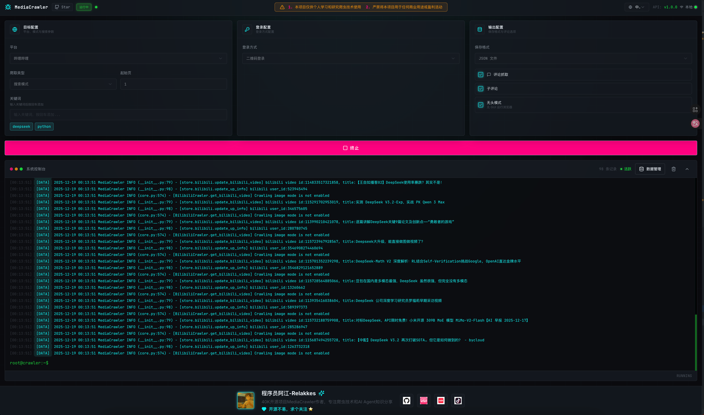
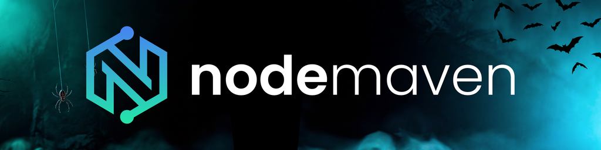
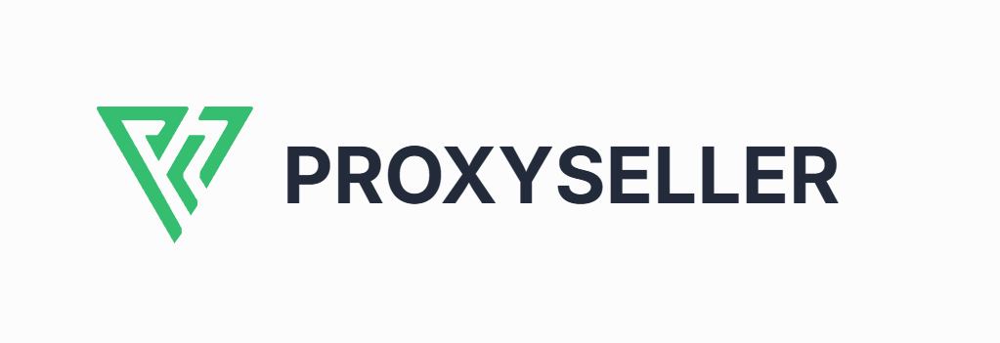
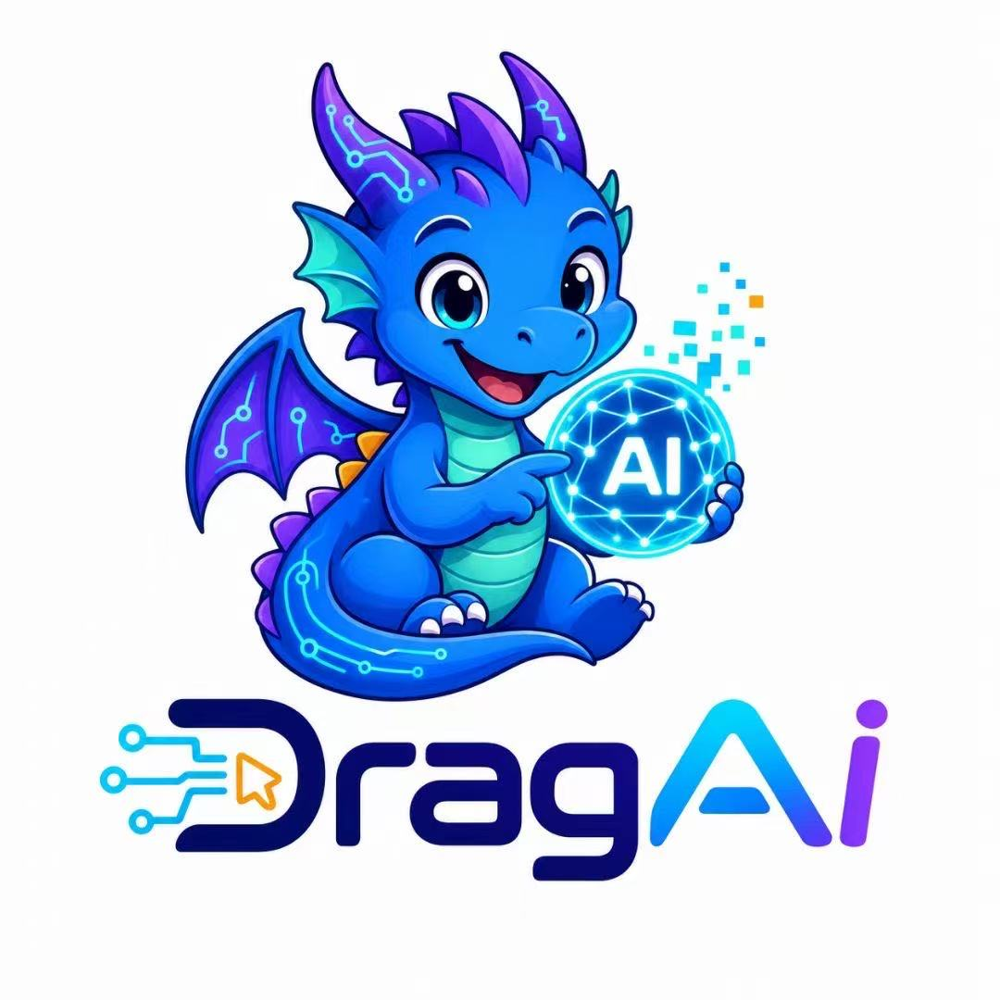

# 🔥 MediaCrawler - ソーシャルメディアプラットフォームクローラー 🕷️

<div align="center">

### 🤝 ゴールドスポンサーに特別な感謝を

<a href="https://www.browseract.ai/mediacrawler" target="_blank">
  
</a>

<br>

<a href="https://www.browseract.ai/mediacrawler" target="_blank">
<small>BrowserAct を使えば、たった一文であらゆる Web サイトからデータを抽出できます。コードは不要で、一度作れば安定して再利用でき、消費するトークンもごくわずかです。BrowserAct は実際のブラウザーを使ってデータ収集 Bot を自動で構築し、ステルスブラウジング、CAPTCHA 対応、住宅用プロキシを内蔵したうえで、構造化された結果を直接出力します。今すぐ無料でお試しください。</small>
</a>

</div>

---

<div align="center">

<a href="https://trendshift.io/repositories/8291" target="_blank">
  
</a>

[](https://atomgit.com/NanmiCoder/MediaCrawler)

[](https://github.com/NanmiCoder/MediaCrawler/stargazers)
[](https://github.com/NanmiCoder/MediaCrawler/network/members)
[](https://github.com/NanmiCoder/MediaCrawler/issues)
[](https://github.com/NanmiCoder/MediaCrawler/pulls)
[](https://github.com/NanmiCoder/MediaCrawler/blob/main/LICENSE)
[](README.md)
[](README_en.md)
[](README_es.md)
[](README_ja.md)

</div>

> **免責事項：**
> 
> このリポジトリは学習目的でのみ使用してください ⚠️⚠️⚠️⚠️、[Web スクレイピングの違法事例](https://github.com/HiddenStrawberry/Crawler_Illegal_Cases_In_China)  <br>
>
>このリポジトリのすべてのコンテンツは学習および参考目的に限られ、商用利用は禁止されています。いかなる個人または組織も、このリポジトリのコンテンツを違法な目的に使用したり、他者の正当な権利や利益を侵害したりしてはなりません。このリポジトリに含まれる Web スクレイピング技術は学習と研究のみを目的としており、他のプラットフォームへの大規模なクローリングやその他の違法行為に使用してはなりません。このリポジトリのコンテンツの使用によって生じたいかなる法的責任についても、このリポジトリは一切の責任を負いません。このリポジトリのコンテンツを使用することにより、本免責事項のすべての条項に同意したものとみなされます。
>
> より詳細な免責事項はこちらをクリックしてご覧ください。[クリックして移動](#disclaimer)

## 📖 プロジェクト紹介

強力な **マルチプラットフォーム対応のソーシャルメディアデータ収集ツール** で、小紅書（Xiaohongshu）、抖音（Douyin）、快手（Kuaishou）、Bilibili、微博（Weibo）、百度貼吧（Tieba）、知乎（Zhihu）などの主要プラットフォームから公開情報をクローリングできます。

### 🔧 技術的な仕組み

- **コア技術**：[Playwright](https://playwright.dev/) ブラウザー自動化フレームワークを基盤とし、ログインとログイン状態の維持を行います
- **JS のリバースエンジニアリングは不要**：ログイン状態を保持したブラウザーコンテキスト環境を利用し、JS 式を通じて署名パラメーターを取得します
- **利点**：複雑な暗号化アルゴリズムをリバースする必要がなく、技術的なハードルを大幅に下げます

## ✨ 機能
| プラットフォーム | キーワード検索 | 指定した投稿 ID のクローリング | 二次コメント | 指定したクリエイターのホームページ | ログイン状態のキャッシュ | IP プロキシプール | コメントのワードクラウド生成 |
| ------ | ---------- | -------------- | -------- | -------------- | ---------- | -------- | -------------- |
| 小紅書 | ✅          | ✅              | ✅        | ✅              | ✅          | ✅        | ✅              |
| 抖音   | ✅          | ✅              | ✅        | ✅              | ✅          | ✅        | ✅              |
| 快手   | ✅          | ✅              | ✅        | ✅              | ✅          | ✅        | ✅              |
| Bilibili   | ✅          | ✅              | ✅        | ✅              | ✅          | ✅        | ✅              |
| 微博   | ✅          | ✅              | ✅        | ✅              | ✅          | ✅        | ✅              |
| 百度貼吧   | ✅          | ✅              | ✅        | ✅              | ✅          | ✅        | ✅              |
| 知乎   | ✅          | ✅              | ✅        | ✅              | ✅          | ✅        | ✅              |


<strong>MediaCrawlerPro がメジャーリリース！オープンソースの継続は簡単ではありません。ぜひサブスクライブしてご支援ください！</strong>

> クローリング技術だけでなく、成熟したプロジェクトのアーキテクチャ設計を学ぶことに注目してください。Pro 版のコード設計思想も、深く学ぶ価値があります！

[MediaCrawlerPro](https://github.com/MediaCrawlerPro) のオープンソース版に対する主な利点：

#### 🎯 コア機能のアップグレード
- ✅ **コンテンツ分析エージェント**（新機能）
- ✅ **クローリングの再開機能**（主要機能）
- ✅ **複数アカウント + IP プロキシプールに対応**（主要機能）
- ✅ **Playwright への依存を排除**し、より使いやすく
- ✅ **Linux 環境を完全サポート**

#### 🏗️ アーキテクチャ設計の最適化
- ✅ **コードのリファクタリングと最適化**により、可読性と保守性が向上（JS 署名ロジックを分離）
- ✅ **エンタープライズレベルのコード品質**で、大規模なクローラープロジェクトの構築に適しています
- ✅ **洗練されたアーキテクチャ設計**により、高い拡張性を持ち、ソースコードの学習価値もさらに高まっています

#### 🎁 追加機能
- ✅ **ソーシャルメディア動画ダウンローダーのデスクトップアプリ**（フルスタック開発の学習に最適）
- ✅ **マルチプラットフォームのホームフィードのおすすめ**（HomeFeed）
- [ ] **コメント分析に基づく AI エージェントを開発中 🚀🚀**

詳細は [MediaCrawlerPro プロジェクトのホームページ](https://github.com/MediaCrawlerPro) をクリックしてご覧ください

## 🚀 クイックスタート

> 💡 **オープンソースの継続は簡単ではありません。このプロジェクトが役に立ったら、ぜひ ⭐ Star で応援してください！**

## 📋 前提条件

### 🚀 uv のインストール（推奨）

次のステップに進む前に、お使いのコンピューターに uv がインストールされていることを確認してください：

- **インストールガイド**：[uv 公式インストールガイド](https://docs.astral.sh/uv/getting-started/installation)
- **インストールの確認**：ターミナルで `uv --version` コマンドを入力します。バージョン番号が正常に表示されれば、インストールは成功です
- **推奨理由**：uv は現在最も強力な Python パッケージ管理ツールで、高速かつ正確に依存関係を解決します

### 🟢 Node.js のインストール

このプロジェクトは Node.js に依存しています。公式サイトからダウンロードしてインストールしてください：

- **ダウンロードリンク**：https://nodejs.org/en/download/
- **バージョン要件**：>= 16.0.0

### 📦 Python パッケージのインストール

```shell
# Enter project directory
cd MediaCrawler

# Use uv sync command to ensure consistency of python version and related dependency packages
uv sync
```

### 🌐 ブラウザードライバーのインストール

```shell
# Install browser driver
uv run playwright install
```

> **💡 ヒント**：MediaCrawler は、playwright を使ってローカルの Chrome ブラウザーに接続できるようになり、Webdriver が原因で起こる一部の問題を解決しました。
>
> 現在、`xhs` と `dy` で CDP モードを使ってローカルブラウザーに接続できます。必要に応じて、`config/base_config.py` の設定項目を確認してください。

## 🚀 クローラープログラムの実行

```shell
# The project does not enable comment crawling mode by default. If you need comments, please modify the ENABLE_GET_COMMENTS variable in config/base_config.py
# Other supported options can also be viewed in config/base_config.py with Chinese comments

# Read keywords from configuration file to search related posts and crawl post information and comments
uv run main.py --platform xhs --lt qrcode --type search

# Read specified post ID list from configuration file to get information and comment information of specified posts
uv run main.py --platform xhs --lt qrcode --type detail

# Open corresponding APP to scan QR code for login

# For other platform crawler usage examples, execute the following command to view
uv run main.py --help
```

## WebUI のサポート

<details>
<summary>🖥️ <strong>WebUI ビジュアル操作インターフェース</strong></summary>

MediaCrawler は Web ベースのビジュアル操作インターフェースを提供しており、コマンドラインを使わずに簡単にクローラーの機能を利用できます。

#### 開発（推奨）

開発時は、バックエンドの API サービスとフロントエンドの Vite 開発サーバーの両方を起動する必要があります：

```shell
# Terminal 1: start API server (default port 8080)
uv run uvicorn api.main:app --port 8080 --reload

# Terminal 2: start frontend dev server
cd webui
npm install
npm run dev        # starts on port 5173 by default and proxies /api to 8080
```

起動に成功したら、`http://localhost:5173/` にアクセスして WebUI インターフェースを開きます。

> 初回起動時には環境チェックが実行される（`/api/env/check` を呼び出す）ため、バックエンドサービスが起動していることを確認してください。チェックに失敗した場合は、「Skip Check」をクリックして一時的にスキップできます。

#### 本番用ビルド

API サーバーから WebUI の静的アセットを直接配信したい場合は、まずフロントエンドをビルドします：

```shell
cd webui
npm install
npm run build      # outputs to api/webui/
```

その後、API サーバーだけを起動します：

```shell
uv run uvicorn api.main:app --port 8080 --reload
```

起動に成功したら、`http://localhost:8080` にアクセスして WebUI インターフェースを開きます。

#### WebUI の機能

- クローラーのパラメーター設定を可視化（プラットフォーム、ログイン方法、クローリングの種類など）
- クローラーの実行状況とログをリアルタイムで確認
- データのプレビューとエクスポート

#### インターフェースのプレビュー



</details>

<details>
<summary>🔗 <strong>Python ネイティブの venv による環境管理を使用する（非推奨）</strong></summary>

#### Python 仮想環境の作成と有効化

> 抖音と知乎をクローリングする場合は、事前に nodejs 環境をインストールする必要があります。バージョンは `16` 以上です

```shell
# Enter project root directory
cd MediaCrawler

# Create virtual environment
# My python version is: 3.9.6, the libraries in requirements.txt are based on this version
# If using other python versions, the libraries in requirements.txt may not be compatible, please resolve on your own
python -m venv venv

# macOS & Linux activate virtual environment
source venv/bin/activate

# Windows activate virtual environment
venv\Scripts\activate
```

#### 依存ライブラリのインストール

```shell
pip install -r requirements.txt
```

#### playwright ブラウザードライバーのインストール

```shell
playwright install
```

#### クローラープログラムの実行（ネイティブ環境）

```shell
# The project does not enable comment crawling mode by default. If you need comments, please modify the ENABLE_GET_COMMENTS variable in config/base_config.py
# Other supported options can also be viewed in config/base_config.py with Chinese comments

# Read keywords from configuration file to search related posts and crawl post information and comments
python main.py --platform xhs --lt qrcode --type search

# Read specified post ID list from configuration file to get information and comment information of specified posts
python main.py --platform xhs --lt qrcode --type detail

# Open corresponding APP to scan QR code for login

# For other platform crawler usage examples, execute the following command to view
python main.py --help
```

</details>


## 💾 データ保存

MediaCrawler は、CSV、JSON、JSONL、Excel、SQLite、MySQL データベースなど、複数のデータ保存方法に対応しています。

📖 **詳しい使い方は [データ保存ガイド](docs/data_storage_guide.md) をご覧ください**

---

[🚀 MediaCrawlerPro がメジャーリリース 🚀！より多くの機能、より優れたアーキテクチャ設計！](https://github.com/MediaCrawlerPro)

### 💬 ディスカッショングループ
- **WeChat ディスカッショングループ**：[クリックして参加](https://nanmicoder.github.io/MediaCrawler/%E5%BE%AE%E4%BF%A1%E4%BA%A4%E6%B5%81%E7%BE%A4.html)
- **Bilibili アカウント**：[フォローする](https://space.bilibili.com/434377496)。AI とクローラー技術の知識を発信しています


### 💰 スポンサー紹介

<table>
  <thead>
    <tr>
      <th width="220">スポンサー</th>
      <th align="left">紹介</th>
    </tr>
  </thead>
  <tbody>
    <tr>
      <td align="center" valign="middle">
        <a href="https://tikhub.io/?utm_source=github.com/NanmiCoder/MediaCrawler&utm_medium=marketing_social&utm_campaign=retargeting&utm_content=carousel_ad"></a>
      </td>
      <td valign="middle">
        <a href="https://tikhub.io/?utm_source=github.com/NanmiCoder/MediaCrawler&utm_medium=marketing_social&utm_campaign=retargeting&utm_content=carousel_ad">TikHub.io</a> は、TK、DY、XHS、Y2B、Ins、X など国内外の 14 以上の主要プラットフォームをカバーする、900 以上の高い安定性を備えたデータインターフェースを提供しています。ユーザー、コンテンツ、商品、コメントなど多次元の公開データ API に対応し、4,000 万件以上のクリーニング済み構造化データセットを備えています。招待コード <code>cfzyejV9</code> を使って<a href="https://tikhub.io/?utm_source=github.com/NanmiCoder/MediaCrawler&utm_medium=marketing_social&utm_campaign=retargeting&utm_content=carousel_ad">登録してチャージ</a>すると、さらに $2 のボーナスがもらえます。
      </td>
    </tr>
    <tr>
      <td align="center" valign="middle">
        <a href="https://go.nodemaven.com/MediaCrawleroctober"></a>
      </td>
      <td valign="middle">
        <a href="https://go.nodemaven.com/MediaCrawleroctober">NodeMaven</a> は、Web スクレイピングと自動化のための効率的なプロキシプロバイダーで、市場で最高品質の IP を提供しています。主な利点は、99.9% の稼働率、ZIP ターゲティング、すべてのプロキシでの IP フィルタリング（不正スコア 97% 未満）、KYC 不要、そして Proxy Bandwidth Checker、Meta Tag Checker、IP Lookup などの独自の無料ツールです。MediaCrawler ユーザーは、コード <code>CRAWLER35</code> でモバイルおよび住宅用プロキシが 35% オフ、コード <code>CRAWLER40</code> で ISP（静的）プロキシが 40% オフになります。👉 <a href="https://go.nodemaven.com/MediaCrawleroctober">NodeMaven にアクセス</a>
      </td>
    </tr>
    <tr>
      <td align="center" valign="middle">
        <a href="https://www.openlux.ai/register?channel=c_drxir46c"></a>
      </td>
      <td valign="middle">
        このプロジェクトをスポンサーしていただいている <a href="https://www.openlux.ai/register?channel=c_drxir46c">OpenLux</a> に感謝します！OpenLux は企業向けのオールインワン AI プラットフォームで、世界の主要プロバイダーの先進的な AI モデルを集約しています。高速で信頼性の高いサービスと迅速な技術サポートを備え、Claude、OpenAI、Gemini モデルの基本料金をそれぞれ公式料金の 8.82%、4%、8% という低価格で提供しています。MediaCrawler ユーザー限定特典：<a href="https://www.openlux.ai/register?channel=c_drxir46c">紹介リンク</a>から登録すると、クレジットのチャージが最大 7.5% オフになります！👉 <a href="https://www.openlux.ai/register?channel=c_drxir46c">OpenLux を始める</a>
      </td>
    </tr>
    <tr>
      <td align="center" valign="middle">
        <a href="https://sx.org/c/CRAWLER3G"></a>
      </td>
      <td valign="middle">
        <a href="https://sx.org/c/CRAWLER3G">SX.ORG</a> は、大規模な Web スクレイピングとボット対策の回避のために構築された高性能なプロキシネットワークで、MediaCrawler と完全に互換性があります。主な利点は、190 以上の地域をカバーするグローバルな動的住宅用 IP、99.9% のネットワーク稼働率、国・都市・ASN 単位の精密なターゲティング、HTTP(S) &amp; SOCKS5 のネイティブサポート、そしてソーシャルメディアプラットフォーム向けの柔軟なセッションローテーションです。MediaCrawler ユーザーは、登録時に専用プロモコード <code>CRAWLER3G</code> を使うと、<strong>3 GB</strong> の無料トライアルトラフィックを受け取れます。👉 <a href="https://sx.org/c/CRAWLER3G">SX.ORG で 3 GB を受け取る</a>
      </td>
    </tr>
    <tr>
      <td align="center" valign="middle">
        <a href="https://proxylane.dev/?utm_source=mediacrawler&utm_medium=partnership&utm_campaign=mediacrawler_sponsor_202610&utm_content=github_readme_en"></a>
      </td>
      <td valign="middle">
        <a href="https://proxylane.dev/?utm_source=mediacrawler&utm_medium=partnership&utm_campaign=mediacrawler_sponsor_202610&utm_content=github_readme_en">ProxyLane</a> は、中国国外のサーバーから MediaCrawler を実行するために、中国本土の住宅用 IP（China Telecom、Unicom、Mobile）を提供しており、出口を上海、北京、広州、深圳などの都市に固定できます。静的モードでプロキシのユーザー名に <code>_c_CN_city_Shanghai</code> を追加すると、上海の住宅用 IP を取得できます。<a href="docs/proxylane/README_en.md">3 ステップのセットアップガイド</a>をご覧ください。MediaCrawler ユーザーは、コード <code>MEDIACRAWLER3GB</code> で登録すると <strong>3 GB</strong> の無料トラフィックを受け取れます。👉 <a href="https://proxylane.dev/redeem?code=MEDIACRAWLER3GB&utm_source=mediacrawler&utm_medium=partnership&utm_campaign=mediacrawler_sponsor_202610&utm_content=github_readme_en">3 GB を無料で受け取る</a>
      </td>
    </tr>
    <tr>
      <td align="center" valign="middle">
        <a href="https://proxy-seller.com/?partner=72D769D7B7FB4A8B"></a>
      </td>
      <td valign="middle">
        <a href="https://proxy-seller.com/?partner=72D769D7B7FB4A8B">Proxy-Seller</a> は、Web スクレイピング、データ収集、自動化のためのプロフェッショナルなプロキシプロバイダーです。住宅用、モバイル（4G/5G/LTE）、静的 ISP、データセンター IPv4 および IPv6 の 5 つの製品ラインを提供し、世界 220 以上の地域をカバーする 4,700 万以上の住宅用 IP と、国・都市・ISP 単位の精密なターゲティングを備えています。主な利点は、99.7% の稼働率、HTTP(S) と SOCKS5 の完全サポート、静的 IP とローテーション IP の柔軟な切り替え、高い同時リクエスト処理能力、RESTful API と多言語 SDK（Python、Node.js、PHP、Java、Go）、そして 24 時間 365 日の技術サポートです。ISO/IEC 27001 と ISO 9001 の認証を取得し、世界中の 185,000 以上の顧客から信頼されており、MediaCrawler やその他のマルチプラットフォームのスクレイピングツールとよく連携します。MediaCrawler ユーザーは、コード <code>MCRAWLER15</code> で 15% オフになります。👉 <a href="https://proxy-seller.com/?partner=72D769D7B7FB4A8B">Proxy-Seller にアクセス</a>
      </td>
    </tr>
    <tr>
      <td align="center" valign="middle">
        <a href="https://dragtokens.com"></a>
      </td>
      <td valign="middle">
        このプロジェクトをスポンサーしていただいている <a href="https://dragtokens.com">DragTokens (Drag API)</a> に感謝します！DragTokens は開発者向けにマルチモデル API のリレーサービスを提供することに注力しており、Claude Code、Codex、Gemini CLI などの AI コーディングツールに対応し、GPT、Claude、Gemini などの主要モデルをカバーしています。料金は、Claude 公式クライアント専用グループで 1.1 倍（公式 API と比べて約 1.55 割、約 84.5% の節約）、Codex で 0.3 倍（約 0.42 割、約 96% の節約）、Gemini で 0.25 倍（約 0.35 割、約 96.5% の節約）という低さで、プール全体のピークスループットは 7 億 TPM に達します。<br><br>
        🎁 <a href="https://dragtokens.com">この専用リンクから登録</a>した新規ユーザーには登録クレジットが付与され、1 回で CNY 100 をチャージすると 10% のキャッシュバックも受けられます！ドキュメントでは、導入方法、ツールの設定、API の例を扱っているので、セットアップから利用までガイドがあります。プロンプトとモデルの応答が保存されることはなく、企業や大学のチーム向けに専用アカウントプール、法人振込、請求書の発行にも対応しています。
      </td>
    </tr>
  </tbody>
</table>

---

### 🤝 スポンサーになる

スポンサーになって、ここであなたの製品を紹介し、毎日大きな露出を得ましょう！

**連絡先**：
- WeChat：`relakkes`
- メール：`relakkes@gmail.com`
---

### 📚 その他
- **FAQ**：[MediaCrawler 完全ドキュメント](https://nanmicoder.github.io/MediaCrawler/)

### 🧩 私のその他のプロジェクト
- **私が立ち上げているスタートアップ**：[ModelDial](https://modeldial.com/?utm_source=github&utm_medium=referral&utm_campaign=mediacrawler&utm_content=readme-en) — プライベートなデータセットで AI モデルをベンチマークし、能力、コスト、推論の労力レベルを比較して、タスクに適したモデルを見つけるお手伝いをします
- **オープンソースのデスクトップエージェント**：[cc-haha](https://github.com/NanmiCoder/cc-haha) — ローカルファーストでクロスプラットフォームのエージェント向けデスクトップワークスペースです。マルチエージェントでの協働、Git worktree、スキルマーケットプレイス、マルチモデル対応、Computer Use を備え、WeChat / Feishu / DingTalk などからのリモートアクセスにも対応しています
- **DeepSeek Harness プラグイン**：[dsh-agent-teams](https://github.com/NanmiCoder/dsh-agent-teams) — DeepSeek Harness に Agent Teams を導入し、複数のエージェントが複雑なタスクを並行して処理できるようにします


## ⭐ Star 推移グラフ

このプロジェクトが役に立ったら、ぜひ ⭐ Star で応援して、より多くの人に MediaCrawler を知ってもらえるようにしてください！

[](https://www.repostars.dev/?repos=NanmiCoder%2FMediaCrawler&theme=ocean)


## 📚 参考資料

- **小紅書の署名リポジトリ**：[Cloxl の xhs 署名リポジトリ](https://github.com/Cloxl/xhshow)
- **小紅書クライアント**：[ReaJason の xhs リポジトリ](https://github.com/ReaJason/xhs)
- **SMS 転送**：[SmsForwarder 参考リポジトリ](https://github.com/pppscn/SmsForwarder)
- **イントラネット貫通ツール**：[ngrok 公式ドキュメント](https://ngrok.com/docs/)


# 免責事項
<div id="disclaimer">

## 1. プロジェクトの目的と性質
本プロジェクト（以下「本プロジェクト」といいます）は、技術研究および学習のためのツールとして作成されたもので、ネットワークデータ収集技術の探求と学習を目的としています。本プロジェクトはソーシャルメディアプラットフォームのデータクローリング技術の研究に焦点を当てており、学習者や研究者に技術交流の場を提供することを意図しています。

## 2. 法令遵守に関する声明
本プロジェクトの開発者（以下「開発者」といいます）は、本プロジェクトをダウンロード、インストール、使用する際に、「中華人民共和国サイバーセキュリティ法」、「中華人民共和国反スパイ法」をはじめとする、適用されるすべての国家の法律および政策を含むがこれらに限定されない中華人民共和国の関連法令を厳格に遵守するよう、利用者に厳粛に注意を促します。本プロジェクトの使用によって生じうるすべての法的責任は、利用者が負うものとします。

## 3. 使用目的の制限
本プロジェクトを、違法な目的や、学習・研究以外の商業活動に使用することは固く禁じられています。本プロジェクトを、他人のコンピューターシステムへのいかなる形態の不正侵入にも使用してはならず、他者の知的財産権その他の正当な権利や利益を侵害するいかなる活動にも使用してはなりません。利用者は、本プロジェクトの使用が純粋に個人の学習と技術研究のためであることを保証しなければならず、いかなる形態の違法行為にも使用してはなりません。

## 4. 免責
開発者は本プロジェクトの合法性と安全性を確保するためにあらゆる努力を払っていますが、利用者が本プロジェクトを使用したことによって生じうる、いかなる形態の直接的または間接的な損失についても一切の責任を負いません。これには、本プロジェクトの使用によって引き起こされたデータの損失、機器の損傷、法的訴訟などが含まれますが、これらに限定されません。

## 5. 知的財産権に関する声明
本プロジェクトの知的財産権は開発者に帰属します。本プロジェクトは、著作権法および国際著作権条約、ならびにその他の知的財産に関する法律および条約によって保護されています。利用者は、本声明および関連法令を遵守することを前提として、本プロジェクトをダウンロードおよび使用することができます。

## 6. 最終解釈権
本プロジェクトに関する最終的な解釈権は開発者が有します。開発者は、事前の通知なしにいつでも本免責事項を変更または更新する権利を留保します。
</div>


## 🙏 謝辞

### JetBrains オープンソースライセンスによるサポート

このプロジェクトに無料のオープンソースライセンスを提供していただいている JetBrains に感謝します！

<a href="https://www.jetbrains.com/?from=MediaCrawler">
    
</a>
